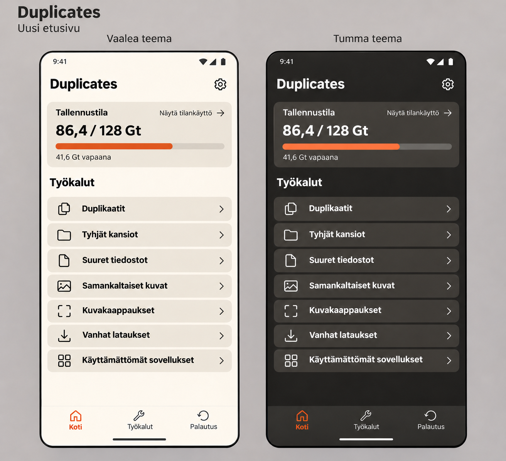
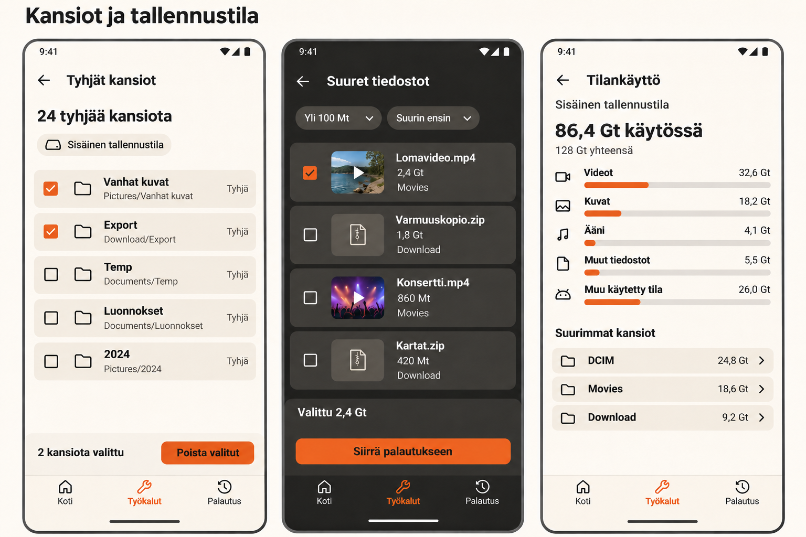
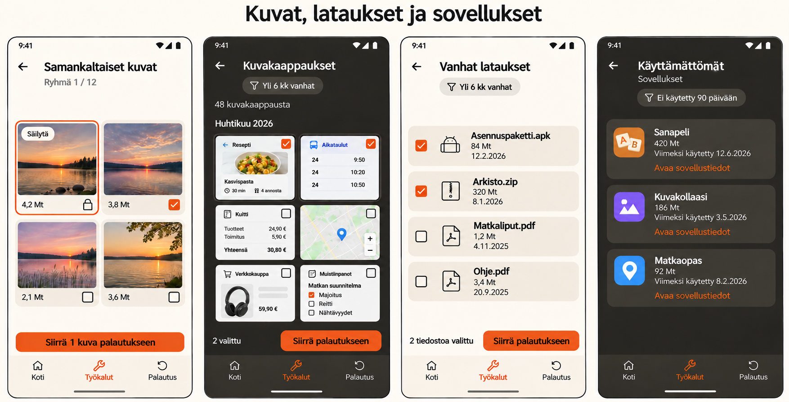

# Duplicates: Storage Cleanup Expansion Implementation Plan

**Date:** 2026-11-03, Europe/Helsinki  
**Status:** Implementation plan only. The new tools described below are not implemented by this planning task.  
**Repository:** Duplicates-Android  
**Inspected baseline:** `8300bb6f383ce5f83b39eb2df8bb6b30e7a47ee1`, branch `codex/results-selection-clarity`, plus the existing uncommitted UI text cleanup.  
**Language:** This plan is English. Preserve the app's existing English resource language unless localization is separately requested.

## 1. Required outcome and scope

Extend the existing exact-duplicate utility with all seven agreed additions:

1. Find and remove empty folders, including folder trees containing only empty descendants.
2. Find and review large files.
3. Show storage usage by file category and folder.
4. Find and compare visually similar photos.
5. Review and remove screenshots.
6. Review and remove old downloads.
7. Identify eligible unused apps and open their Android app-details screen.

Keep exact duplicate detection, existing scan scope selection, exclusions, previews, recovery copies, and settings working. Add the Home, Tools, and Recovery navigation shown in the approved images.

**The implemented app MUST look as close to the approved reference images as possible.** These images are the visual acceptance reference, not optional inspiration. Match the screen hierarchy, palette, typography, row and card composition, controls, thumbnails, spacing, bottom navigation, and restrained amount of text. Do not substitute an unrelated design.

The user's later instruction removing explanatory text takes precedence over the first mockups, the historical redesign plan, and earlier descriptive UI copy. Do not reintroduce removed text while implementing the new tools.

This work does not include cloud scanning, accounts, analytics, advertising, subscriptions, scheduled cleanup, automatic deletion, cache cleaning, RAM or battery optimization, contact cleanup, antivirus features, or a general-purpose file manager. Do not introduce Hilt, Navigation 3, a new UI framework, a new module architecture, or unrelated SDK/dependency upgrades.

## 2. Approved images: authoritative local references

Use only these revised, text-minimal images. Repository-local copies are included so implementation does not depend on a particular user's Codex directory.

### 2.1 Home in both themes

[Open the approved Home reference](storage-cleanup-reference/duplicates-home.png)

The tool rows have names, icons, and chevrons only. Their earlier explanatory subtitles are intentionally absent.

### 2.2 Empty folders, large files, and storage usage

[Open the approved storage tools reference](storage-cleanup-reference/duplicates-storage.png)

The residual storage category is **Other used space**, corresponding to **Muu käytetty tila** in the image. Do not rename it to Apps and system and then add an explanatory disclaimer.

### 2.3 Similar photos, screenshots, old downloads, and unused apps

[Open the approved media and apps reference](storage-cleanup-reference/duplicates-media-apps.png)

The first similar photo is marked to keep and has a lock. The second photo is selected for removal. A kept photo must never simultaneously look selected for deletion.

### 2.4 Reference identity and interpretation

| File | SHA-256 |
| --- | --- |
| `duplicates-home.png` | `645A27BE94072F765630D524B545EEDCC98D7962A7264797E4F2FB00529E4ED8` |
| `duplicates-storage.png` | `7576D62CFCB01BCA482BB8F742BC6EE7964552D687205B59F9870D2718937A28` |
| `duplicates-media-apps.png` | `933E16BC390B56CE6F479A49D072CF75312A99210D4EC69F754645C184EC5E1D` |

The files were copied byte-for-byte from the latest approved image revisions in the current conversation. Do not use the earlier versions with helper paragraphs.

Interpretation rules:

- Mockup counts, dates, capacities, filenames, photos, and app names are fixture data, not production constants.
- The Finnish text in the images identifies the intended controls. Use concise English equivalents in the current English app. This plan does not authorize a separate localization project.
- Render the app contents, not the presentation-board titles, phone outlines, painted status bars, or surrounding background.
- Respect actual system bars, edge-to-edge insets, keyboard, accessibility settings, and device dimensions.
- Generated-image texture and tiny rendering defects are not requirements. Use flat native Compose surfaces and the existing design tokens.
- Do not copy arbitrary empty space left behind by image editing. Keep the same visual hierarchy with natural content spacing.
- At narrow widths or large font settings, allow wrapping, scrolling, and fewer grid columns. Readability and reachable controls take priority over a fixed screenshot silhouette.
- Any material visual deviation must be explained in the implementation report and supported by a platform, data, or accessibility constraint.

## 3. Verified implementation baseline

Paths in this section are relative to `app/src/main/java/com/emma/duplicates/`, unless a repository-relative prefix is shown.

| Area | Existing source and verified behavior | Required approach |
| --- | --- | --- |
| Wiring | `app/DuplicatesApplication.kt` defines the manual `AppContainer` and shared deletion mutex | Extend this wiring; do not introduce a DI framework |
| Navigation | `app/Routes.kt`, `AppNavigation.kt`, `AppDestinations.kt`, `AppNavigationActions.kt`; typed serializable Navigation Compose routes | Add the bottom shell and tool destinations using this stack |
| Exact scans | `app/ScanRunner.kt`, `ScanWork.kt`, `DuplicateScanWorker.kt` | Preserve existing session activation and foreground-work behavior |
| Discovery | `core/storage/FileDiscovery.kt`; scoped, cancelable file traversal with exclusions and path checks | Reuse file discovery where appropriate; empty folders require a distinct directory result |
| Metadata | `core/storage/MediaStoreMetadataIndex.kt`, `core/model/FileMetadata.kt` | Reuse path/volume identity, MIME/category data, favorites, trash state, and preview metadata |
| Duplicate proof | `core/storage/ExactDuplicateScanner.kt` | Keep size grouping, fingerprints, full SHA-256 and byte comparison unchanged |
| Deletion | `domain/deletion/DeletionCoordinator.kt`, `DeletionModels.kt`, `PendingDeletionReconciler.kt` | Preserve keep-one-valid-copy rules for exact duplicates |
| Storage mutation | `data/AndroidDeletionStorage.kt`, `data/RecoveryRepository.kt` | Reuse atomic same-volume recovery moves and restore behavior |
| Persistence | `core/database/DuplicatesDatabase.kt`, `Entities.kt`, `Daos.kt`, `RecoveryFile.kt` | Current Room version is 4; use an additive migration for necessary new state |
| Preferences | `data/preferences/PreferencesRepository.kt` | Keep one DataStore owner; reuse theme, scope, hidden-folder, exclusion, and confirmation preferences |
| UI | `ui/home/`, `ui/results/`, `ui/settings/`, `ui/components/`, `core/designsystem/` | Reuse native controls and existing tokens |
| Preview | `data/FilePreviewLauncher.kt`, `PreviewFileProvider.kt`, `ui/preview/PreviewScreens.kt` | Add file identity support for non-duplicate results without requiring a duplicate-group ID |
| Formatting | `core/format/DisplayFormatters.kt` | Preserve decimal units: 1 MB = 1,000,000 bytes |
| Permissions | `app/src/main/AndroidManifest.xml`, `core/permissions/StorageAccessManager.kt` | Existing all-files access; no INTERNET permission; add only the access needed for app usage |

The inspected toolchain declares min SDK 30, compile/target SDK 37, JVM target 17, AGP 9.5.0, Kotlin 2.4.21, Navigation Compose 2.10.2, Room 2.8.5, WorkManager 2.12.0, and Coil 3.6.3. These are repository values, not recommendations to upgrade.

Important implementation gaps:

- The existing discovery result contains files, not an inventory of empty directories.
- Discovery deliberately skips zero-byte files. A skipped zero-byte file still makes a directory nonempty.
- Existing exact-deletion records require group/member identities. Do not invent duplicate groups for ordinary files.
- `RecoveryRepository.move` already accepts a staged-file verification callback, but its current caller verifies against another identical copy.
- Recovery records are durable before rename. Verified payloads receive at least 30 days of retention. Restore does not overwrite existing destinations and retains the recovery payload.
- Recovery copies still occupy storage. Preserve honest byte totals without adding explanatory paragraphs.
- The existing UI has no bottom navigation, no usage-access feature, and no installed-app inventory.
- The app is English-only today. Earlier text-removal changes are already present in the working tree and must be preserved.
- `PROJECT.md` currently lists similar media and general cleaner features as non-goals. This plan supersedes only the non-goals explicitly covered by the seven additions above. Update that document after implementation, not by pretending the planned features already exist.

## 4. Product and visual contract

### 4.1 Global visual rules

Reuse the current tokens:

| Token purpose | Dark | Light |
| --- | --- | --- |
| Background | `#252422` | `#FFFCF2` |
| Main card surface | `#403D39` | `#F0EBE1` |
| Primary text | `#FFFCF2` | `#252422` |
| Secondary text | `#CCC5B9` | `#625E58` |
| Accent | `#EB5E28` | `#EB5E28` |

- Keep existing typography and shapes as the starting point. Use approximately 16 dp page margins, 12-16 dp card padding, and 8-12 dp inter-card gaps, adjusting against the references.
- Use existing Material outline icons and existing project icon resources wherever possible.
- Use square checkboxes with an orange selected state. Selection targets must remain at least 48 dp.
- Orange is for actions, active navigation, selected controls, and data bars. No decorative colored vertical stripes.
- No gradients, glows, large illustrations, promotional cards, new animations, or oversized hero content.
- No middle dots, bullets, or other round symbols as text/value separators. Keep the existing string punctuation policy.
- Display metadata on separate lines when needed. Never compress paths, dates, and sizes into unreadable separator-heavy strings.
- Preserve the image's orange button treatment with dark text. Check contrast rather than changing every label to white.
- Active bottom navigation uses the orange icon/label treatment. Validate legibility in light and dark themes.

### 4.2 Text policy: binding requirement

Remove redundant prose, not the information required to identify an action or understand its actual result.

Never add these sentences, English equivalents, or reworded versions with the same purpose:

| Rejected reference text | Rejected English meaning |
| --- | --- |
| Kuvat muistuttavat toisiaan. | These photos look alike. |
| Vertaa kuvia ennen valintaa. | Compare photos before selecting. |
| Vanha tiedosto voi silti olla tärkeä. | An old file may still be important. |
| Poistaminen tehdään Androidin asetuksissa. | Removal is performed in Android settings. |
| Tarkista kansiot ennen poistamista. | Review folders before deleting. |
| Tyhjyys tarkistetaan uudelleen ennen poistoa. | Emptiness is checked again before deletion. |
| Palautuskopiot vievät tilaa säilytysajan. | Recovery copies occupy storage during retention. |
| Sovellusten ja järjestelmän osuus on arvio. | The apps and system share is an estimate. |

Also do not restore the removed scan reassurance, exclusions explanation card, file-type subtitles, recovery introduction, or Home feature subtitles.

Allowed text has a concrete purpose:

- Screen and section titles.
- Tool names, file/app names, paths, sizes, dates, counts, and filter values.
- Button labels and selection/keeper states.
- A concise empty state or actionable error.
- A concise required-access state and its settings action.
- Necessary deletion confirmation details: actual scope, selected count/bytes, and consequential recovery limits.
- Hidden-selection counts when a filter hides items that will still be affected.
- Recovery expiry dates and exceptional verification states.

Do not replace paragraphs with info icons, tooltips, expandable help cards, or onboarding that the user did not request. Safety checks belong in behavior and tests.

### 4.3 Navigation and entry points

Use three root tabs: **Home**, **Tools**, **Recovery**.

- Home matches reference 2.1: app title and settings gear, storage summary with **View storage usage**, then seven tool rows in the exact illustrated order.
- If storage access is missing, keep the tool menu reachable and show a compact access action in the storage area. Gate file operations individually; do not block Unused apps behind an unrelated all-files permission screen.
- The tool rows are **Duplicates**, **Empty folders**, **Large files**, **Similar photos**, **Screenshots**, **Old downloads**, and **Unused apps**.
- Tools reuses the same tool list without the Home storage overview. It is a direct tool launcher, not an additional dashboard with explanatory cards.
- Recovery opens the existing recovery list, now reachable directly. The Settings shortcut may remain as an alias to the same destination/state.
- Home's existing duplicate-scan setup moves behind **Duplicates**. Preserve its scope picker, file-type selection, Scan action, active scan access, and previous results.
- Storage usage opens from Home's storage action. It belongs visually to Tools.
- Tool details show Tools as the active tab. Back returns to the actual launch origin and restores its scroll position; do not build duplicate root destinations.
- Root-tab changes preserve each existing result session and selection. They must not restart scanning or delete selections.
- Keep the tab bar on the illustrated tool result pages. Hide it for full-screen photo preview and nested picker/dialog flows where it would interfere.
- Keep action footers above bottom navigation and system insets. Give scrolling content sufficient bottom padding.
- Notification taps must reopen the correct tool/run, not whichever tool was last visible.
- Never pass a raw filesystem path from navigation directly into deletion. Resolve stable IDs through the current session/repository.

## 5. Shared behavior and data ownership

### 5.1 Scope, permissions, and exclusions

- Reuse selected mounted volumes and selected folders/files for the file tools.
- Capture the effective scope at scan start. A missing selected location must never broaden the scan to the whole device.
- Exact duplicate file-type switches remain specific to duplicate scans. They must not accidentally disable Screenshots or Similar photos.
- New file tools apply their inherent type rules plus existing hidden-folder/system-folder settings and exclusions.
- Old downloads additionally intersect the scope with recognized download locations.
- Empty-folder traversal uses directories within scope. An individual-file-only selection yields an empty result, not a broader directory scan.
- The whole-volume storage overview deliberately measures the selected volume, not only the duplicate scan's selected folders. Read-only totals may include excluded user folders; exclusion still prevents destructive actions.
- Exclude symlinks, restricted Android paths, app-owned payload locations, and recycle-bin payloads from cleanup candidates.
- All-files access does not expose arbitrary private application storage. Do not add root, ADB, accessibility-service automation, or permission bypasses. See [Android all-files access](https://developer.android.com/training/data-storage/manage-all-files).
- Missing access produces a concise access state, not a success result with zero items.
- Request usage access only when opening Unused apps. Other tools remain usable without it.

### 5.2 Run lifecycle and concurrency

Use the existing WorkManager pattern for operations that can outlive a screen. Do not perform traversal, hashing, image decoding, or package-size queries on the main thread.

Required states: **Idle**, **Running**, **Completed**, **Canceled**, **Failed**. Preserve known failure causes and an explicit completeness flag when a result is partial.

- Opening a file tool starts its first read-only scan if no usable session exists. Subsequent openings restore the last completed result; a Refresh action starts another scan.
- Preserve the previous completed result until a new run completes and becomes active transactionally.
- Capture tool kind, run ID, roots, preferences, thresholds, and start time in the session.
- A second tap must attach to the active run, not enqueue duplicate work.
- Start with one storage-intensive scan at a time across exact and new file tools. Reuse the existing coordination pattern; no scheduler framework or persistent queue is required.
- Cancel stops work cooperatively. It does not clear the previous completed session.
- Navigate on completion only if the matching tool destination is still resumed and waiting for that run.
- A notification shows the real tool/phase and supports Stop. Notification denial must not be interpreted as a scan failure.
- Serialize all mutations through the same operation gate, including exact deletion, new file cleanup, and empty-folder removal.
- Do not run a new scan against an unreconciled mutation. Recheck the gate when the user confirms.
- On process restart, reconcile pending operations and interrupted sessions before enabling another mutation.
- Returning from Android app settings refreshes the app list. It must not trigger another unrelated file scan.

### 5.3 Minimal persistence additions

Keep exact-scan tables and algorithms intact. Add only state required for new results, selection restoration, and safe mutation.

Proposed owners/names below are implementation targets, not claims that files already exist:

| Proposed model | Minimum responsibility |
| --- | --- |
| `ToolScanSession` | Tool kind, run ID, status, captured scope/filter parameters, timestamps, counts, completeness/error state, active flag |
| `ToolItem` | Session ID and stable item ID, volume ID, canonical path, item kind, name, size, modification time, MIME/category, optional content URI, selection |
| Similar-photo fields | Group ID, keeper flag, orientation-aware dimensions and perceptual fingerprint/version where needed |
| `CleanupOperation` | Operation ID, tool kind, timestamps, operation state |
| `CleanupOperationItem` | Frozen item identity, intended action, selected snapshot, verification digest for file moves, state/outcome, recovery-record linkage |

Implementation constraints:

- Add a `ToolResultStore` using Room and explicit typed models. Do not use arbitrary JSON as an unvalidated deletion request.
- Use separate new tables for tool sessions/items and cleanup operations/items. Existing exact-delete group/member tables are not a suitable substitute.
- Keep the current `RecoveryFile` payload model unless a proven requirement demands an additive change.
- Migration target is version 5 if version 4 is still current at implementation. If another task has advanced the schema, use the actual next version.
- Preserve all old sessions, preferences, exclusions, fingerprint entries, pending exact deletions, and recovery records.
- Export the new Room schema and test both 4-to-next and the full supported migration chain. No destructive fallback.
- Keep only the latest completed result plus an active replacement per tool, except records referenced by a pending operation.
- Persist selected IDs and keeper choices against their session, not list positions.
- Keep filter and scroll state with the destination/ViewModel. Persist only settings whose behavior requires survival across restart.
- Do not add a permanent app-usage database or scheduled usage collection. Refresh app usage on demand.
- Do not store photo contents or thumbnails in Room. Use existing preview/thumbnail loading.

### 5.4 Selection and preview rules

- New cleanup results start with no files/folders selected. Do not apply the exact-duplicate auto-selection preference to unique files or similar photos.
- A row/thumbnail tap previews or opens the appropriate detail; a separate checkbox selects it.
- Changing a filter does not silently clear a selection. The footer includes all selected items and shows a concise hidden-selection count.
- Confirmation uses a frozen selection snapshot. A later filter change or repeated activity callback must not broaden or repeat the operation.
- Preview supports ordinary files without requiring a duplicate group. Reuse secure temporary URI grants and stale-URI handling.
- Selection and preview remain separate at 320 dp and 200% font scale.
- Do not show estimated freed bytes for folders. For files, label selected bytes as selected bytes, not already freed space.
- After each mutation, refresh affected selections and totals and invalidate overlapping results in other tools. Do not leave a moved file selectable in an older result.

## 6. Recovery and deletion design

### 6.1 Ordinary files need their own coordinator

Add a small `CleanupCoordinator` for explicitly selected files from Large files, Screenshots, Old downloads, and Similar photos.

**Do not weaken `DeletionCoordinator` or remove its valid-keeper check to accommodate ordinary files.** An ordinary selected file may be the only copy. Its authorization comes from the explicit selection and confirmation, not from proof that another identical copy exists.

Reuse low-level storage, media authorization, atomic staging, recovery retention, and formatting where their contracts fit. Avoid a generalized policy engine with interchangeable unsafe deletion modes.

Required file-move sequence:

1. Resolve selected IDs from the current active session and freeze the intended batch.
2. Validate volume, scope, exclusion status, regular-file type, path identity, and current read/write access.
3. Compare current metadata with the reviewed result. Changed/missing/inaccessible files are skipped with an accurate outcome.
4. Compute a full SHA-256 verification snapshot of eligible selected files off the main thread. Check identity and metadata before and after reading; abort that item on instability.
5. Present the existing-style concise confirmation with the actual eligible count/bytes. Honor the existing confirmation preference consistently; this never permits automatic selection or deletion.
6. Obtain Android media write authorization when required, using the existing authorizer. Authorization itself must not delete anything.
7. Recheck the frozen selection, operation gate, file snapshot, and digest after authorization and immediately before staging.
8. Persist the operation/item journal before mutation. Reuse the recovery repository's durable record-before-rename ordering.
9. Move the selected entry atomically to a same-volume recovery payload. No copy-then-delete fallback.
10. Verify the staged payload against the captured digest and identity. Do not verify it against an unrelated keeper.
11. Only verified moves receive normal expiry. On verification failure or cancellation, retain an identifiable unexpired recovery record and restore safely where possible.
12. Checkpoint each item and update every affected result atomically. Refresh MediaStore by validated path.
13. Report moved, skipped/failed, and actually freed bytes. Moving into recovery normally frees zero bytes immediately.

This verification does not justify reading every large file during the discovery phase. Discovery is metadata-based; full-content verification is scoped to the requested mutation.

### 6.2 Recovery continuity

- All new file tools use the same Recovery destination as exact duplicates.
- Preserve the current minimum 30-day verified retention, per-item expiry, no-overwrite restore, and retained restored payload behavior.
- Do not add an Empty recovery button, immediate permanent-delete mode, or a new retention setting.
- Missing/offline storage must defer reconciliation, not look like a successful removal.
- For ordinary files, link the pending operation to its recovery record before the move can become untraceable.
- Test interruptions before the journal, after the journal, after rename, during verification, and during final database completion.
- Process restart must not repeat a completed move, expire an unverified payload, or classify an inaccessible source as confirmed absent.
- Protect ancestors of original paths referenced by live recovery records from empty-folder deletion, so the new tool does not break existing restoration into those folders.

### 6.3 Empty directories use a separate path

Empty directories are removed directly with a non-recursive directory-removal primitive. They do not become file recovery payloads.

- No recursive-delete helper, no walk-and-delete-files implementation, and no fallback that removes nonempty content.
- A directory that gained a child after scanning is skipped.
- Validate all path components, root containment, mount identity, and symlink status again before removal.
- Persist enough per-item intent/outcome to reconcile an interrupted directory batch.
- Missing directories are already absent, not newly deleted by this operation.
- Report folder counts only. Do not invent byte savings or offer a file-style Restore action for a removed directory.

## 7. Feature specifications

### 7.1 Empty folders

**Reference:** storage board, left screen.

UI:

- Header with Back and **Empty folders**.
- Result count and effective storage/scope control.
- Folder rows with square checkboxes, folder icon, name, path, and a short empty-state value only where useful.
- A fixed footer with selected folder count and **Delete selected**.
- No introduction, review instruction, revalidation explanation, or reclaimed-space estimate.

Detection:

1. Walk directories post-order within the effective scope.
2. Inspect actual children, including hidden entries and zero-byte files, when establishing emptiness.
3. A directly empty directory has no entries.
4. An empty tree contains directories only, and every descendant was successfully inspected and is empty by the same rule.
5. A symlink, a regular file, an excluded/unreadable/uninspected child, or failed enumeration makes that branch ineligible.
6. Skipping a child due to preferences is not proof that its parent is empty.
7. Never propose a storage-volume root, a selected scan anchor itself, protected Android/application/recovery directories, or an ancestor needed by a live recovery record.
8. Keep traversing other independent branches after a local read error and mark the run partial when appropriate.
9. Use an iterative traversal, cancellation checks, and bounded metadata retention; do not depend on recursion depth.

Nested selection:

- Selecting an eligible parent selects its eligible empty descendants as part of that explicit operation.
- Count unique directory identities, not overlapping tree entries.
- Deselecting a child deselects dependent ancestors that could no longer be removed; retain unrelated selected leaves.
- Freeze the actual directory set for confirmation.
- Remove deepest directories first, rechecking each immediately before its non-recursive removal.
- If one child becomes nonempty or fails, skip its dependent ancestors. Other independent selected branches can still succeed.

Acceptance:

- A truly empty folder is found and can be removed.
- A tree of empty subfolders can be removed after explicit parent selection.
- A folder containing only `.nomedia`, a zero-byte file, a hidden item, or a symlink is not classified as empty.
- A denied directory listing is not treated as an empty array.
- A file created between scan and delete survives, and its directory is skipped.
- A scan anchor, volume root, excluded directory, and protected recovery ancestor cannot be removed.
- Read-only or detached storage yields an accurate failure/skip, never fake success.

### 7.2 Large files

**Reference:** storage board, middle screen.

- Default filter: **Over 100 MB**, strictly greater than 100,000,000 bytes.
- Filter choices: Over 100 MB, Over 500 MB, Over 1 GB. Keep the choices in one compact dropdown/chip.
- Default sort: largest first; offer smallest first, newest, and oldest in the existing sort-control pattern.
- Tie-break deterministically by canonical path and volume identity.
- List regular accessible user files of all categories. Do not require duplicate membership.
- Rows show thumbnail/type icon, name, size, and parent path.
- File dates are metadata, not proof of usefulness.
- The footer shows selected bytes and **Move to recovery**. No storage-retention helper sentence.
- Use the ordinary-file coordinator, not exact deletion.
- A changed size can invalidate both filter membership and the reviewed snapshot; refresh that item before allowing another removal.

Tests must cover exact threshold boundaries, decimal-unit agreement, sparse/large files without whole-file buffering, equal-size ordering, hidden selections, and a unique file successfully entering Recovery without any duplicate keeper.

### 7.3 Storage usage

**Reference:** storage board, right screen.

- Show one selected mounted volume at a time. Default to the primary volume when available.
- Header: **Storage usage**; selected volume name; used and total storage.
- Categories in the illustrated order: Videos, Photos, Audio, Other files, Other used space.
- Use horizontal bars and right-aligned sizes. Do not add a pie/donut chart or percentage labels absent from the reference.
- Below the categories, show **Largest folders** with folder names, sizes, and chevrons.
- Folder navigation remains read-only. Do not introduce arbitrary recursive folder deletion.

Calculation rules:

- Reuse the existing volume-stat provider for actual capacity/free-space values.
- Take a coherent run snapshot of volume totals and discovered files.
- Count each file once per volume/category. Handle overlapping selected paths without duplication.
- Count descendants once within each ancestor's folder total. Do not sum parent and child totals as independent categories.
- For the root list, show immediate child folders ordered by their descendant total; tapping a folder shows its immediate children.
- Keep categories mutually exclusive. Archives, installers, and unsupported ordinary file types belong to Other files.
- Maintain a consistent accounting basis. File logical sizes are not automatically equal to filesystem allocated bytes.
- Populate Other used space only when it is a valid nonnegative residual of compatible measurements. If measurement races or accounting differences prevent this, keep the value unknown and offer Refresh rather than clamping it into a false zero.
- Do not present the residual as measured app/system usage. Do not request usage access just to render this overview.
- If access prevents complete traversal, use a concise **Partial scan** state with the available results; do not present an inaccessible folder's size as zero.
- Excluded user folders may contribute read-only storage totals, but remain excluded from cleanup actions.
- Include recovery payload consumption in overall used storage; do not expose those payloads as cleanup candidates.
- Display all numbers from the current volume. Do not combine primary and SD-card totals into a mismatched denominator.

Acceptance: a fixture with known category sizes and nested folders produces correct non-overlapping totals, the largest-folder order is stable, drill-down works, missing measurements remain unknown, and a detached volume does not silently switch the displayed totals to another volume.

### 7.4 Similar photos

**Reference:** media/apps board, first screen.

This is a similarity tool. It must not change the definition of an exact duplicate.

UI:

- Header **Similar photos** and compact **Group 1 / 12**-style progress.
- Two-column thumbnail grid at ordinary width, with size below each image.
- One explicit keeper with a **Keep** label, outline, and lock. It has no deletion checkbox.
- Other photos have square selection checkboxes. Start with none selected.
- Provide a concise **Keep** action in photo preview to choose a different keeper.
- Choosing a new keeper clears its deletion selection and unlocks the previous keeper.
- Support previous/next group navigation using compact controls; do not make gestures the only navigation method.
- Tapping an image opens the existing-style full-screen photo preview, including zoom and metadata.
- Fixed action for the selected photos; no similarity explanation or comparison advice.

Initial local algorithm:

1. Enumerate supported still-image candidates within scope. Skip undecodable files and unsupported/animated formats with an accurate skipped count.
2. Decode bounded thumbnails, normalize orientation, and obtain oriented dimensions. Never decode every full-resolution image into memory at once.
3. Use a deterministic 64-bit perceptual fingerprint. Start with dHash over a 9 by 8 grayscale sample; keep the algorithm/version explicit and covered by fixtures.
4. Initial match threshold: Hamming distance at most 6, with oriented aspect ratios within 5%, defined symmetrically as abs(r1 - r2) / max(r1, r2) <= 0.05. Reject invalid dimensions. These are proposed implementation defaults to validate against the fixture corpus, not established quality results.
5. Candidate discovery must not blindly compare every pair in a large library. A simple index of seven disjoint fingerprint bands can generate candidates: with at most six changed bits, at least one band must match. Verify full distance and aspect ratio for every candidate.
6. Deduplicate candidate pairs and process them incrementally with cancellation checks. Do not silently truncate a large candidate bucket.
7. Avoid transitive chaining. Use deterministic grouping in which every member meets the configured match condition against every other member, rather than joining an arbitrarily long A-B-C chain.
8. Choose an initial keeper deterministically: protect favorites, then prefer higher pixel dimensions, then larger file size, then stable path order. This is a recommendation to keep, not proof of an original.
9. Do not mark images as byte-identical unless the existing exact algorithm proves that separately. Exact copies may also appear in this tool without changing its selection rules.
10. Test the threshold on resized/recompressed versions, mild edits, burst photos, and unrelated lookalikes. If quality is inadequate, refine the local fingerprint within this scope and document the evaluated choice before release.

Boundaries:

- No cloud model, paid API, face recognition, OCR, video/audio similarity, or promise to detect every crop/rotation/edit.
- No confidence percentage unless calibrated evidence supports its meaning; it is not required by the reference.
- No automatic removal or default deletion selection.
- A valid keeper must remain accessible at confirmation and immediately before each staged move.
- Similarity does not prove equivalent content. Selected files must be verified against their own captured content digest for Recovery.
- On changed/missing keeper, stop that group and require a new selection; do not silently switch to a different keeper during removal.

Acceptance: controlled positive fixtures group correctly, negative fixtures are not automatically grouped, transitive-chain fixtures do not collapse into one misleading group, keeper changes preserve selection invariants, and original bytes can be restored after removing a non-identical similar photo.

### 7.5 Screenshots

**Reference:** media/apps board, second screen.

- Default age filter: **Over 6 months**. Also offer All and Over 1 year.
- Use the same captured calendar-month cutoff and strict-before comparison defined for Old downloads.
- Group the grid by month/year with a compact heading.
- Within each group, order newest first, with a stable path tie-break.
- Two columns at ordinary width; use one column when necessary for 320 dp/200% layouts.
- Square selection controls are independent from image-preview taps.
- Footer shows selected count and **Move to recovery**.
- Do not run image-content interpretation or OCR to guess screenshot meaning.

Identification:

- Prefer validated MediaStore relative-path/bucket information for known screenshot directories.
- Support tested directory aliases where devices use different screenshot locations.
- Use filesystem path membership as the fallback when MediaStore is absent/stale.
- A filename containing "screenshot" is not sufficient by itself.
- A screenshot result must still resolve to an accessible in-scope regular image.
- Exclude trashed files and app-owned recovery copies.
- Date filter uses the selected file's modification timestamp consistently. Do not label it as a capture date when that is not verified.
- Unknown or invalid dates appear only under All, with a compact unknown-date grouping rather than an invented date.

Acceptance: ordinary camera photos are excluded, screenshots in known directories are included, non-image files in those directories are excluded, selected items survive filter changes with truthful totals, and missing thumbnails do not remove access to the item or its checkbox.

### 7.6 Old downloads

**Reference:** media/apps board, third screen.

- Default filter: **Over 6 months**. Offer Over 1 year and All.
- Use calendar-month subtraction in the device time zone, captured once per scan. The comparison is strictly before the cutoff instant.
- Default order: oldest first, then stable path/volume identity.
- Candidates are accessible files within recognized public Download directories or validated local MediaStore Downloads membership, intersected with user scope.
- Do not infer a download solely from an APK, ZIP, or PDF extension elsewhere on the device.
- APKs are ordinary files here. Never install or uninstall an app when a user previews or removes an APK.
- Rows show type icon, filename, size, and modification date as in the reference.
- Unknown/future dates must not qualify as old. All can display them without an age claim.
- A timestamp does not establish last access or lack of use. Do not call these files unused.
- No caution sentence about old files.
- Selected files use the common recovery coordinator.

Tests: boundary instant, month-end, leap year, daylight-saving transitions, moved-in files, stale MediaStore rows, wrong-location APKs, unknown timestamps, missing selected download roots, and an ordinary unique document round-trip through Recovery.

### 7.7 Unused apps

**Reference:** media/apps board, fourth screen.

This screen provides inspection and an **Open app details** action. It does not directly uninstall apps or route them through file Recovery.

UI:

- Header **Unused apps**. Wrap naturally rather than splitting the title into an explanatory subtitle.
- Compact **Not used for 90 days** filter; also offer 30 days and 180 days.
- Rows contain the actual app icon/name, size when available, last-used date when known, and **Open app details**.
- No selection checkboxes, batch remove action, fake freed-space total, or explanation about Android settings.

Platform integration:

- Use on-demand `UsageStatsManager` access and recheck access on resume. Declaring `PACKAGE_USAGE_STATS` alone is insufficient. Aggregated usage is suitable for a longer window; raw events are retained only briefly and cannot alone establish a 90-day history. See [UsageStatsManager](https://developer.android.com/reference/android/app/usage/UsageStatsManager).
- Discover visible user-launchable apps using a scoped MAIN/LAUNCHER intent query. Do not assume every installed package is visible or add `QUERY_ALL_PACKAGES` by default. See [package visibility declarations](https://developer.android.com/training/package-visibility/declaring).
- Exclude Duplicates and system/updated-system packages from the proposed user-app cleanup list.
- Stay within the current Android user/profile. Do not attempt cross-profile inventory or managed-profile bypasses.
- Read aggregate history with a lookback longer than the largest filter, initially up to one year, and use the maximum valid observed activity-use timestamp for each package.
- Missing rows, zero timestamps, insufficient history, locked-user results, and denied access are unknown states, not proof of non-use.
- Do not show a package as unused for N days unless its available data supports that classification. Newly installed packages without trustworthy history are not automatic candidates.
- Account for known foreground-service activity when available so actively running service-oriented apps are not presented as inactive merely because their UI was not opened. The platform exposes activity-use and foreground-service-use timestamps separately. See [UsageStats](https://developer.android.com/reference/android/app/usage/UsageStats).
- This is an inactivity candidate list, not a claim that an app is safe to uninstall. Keep the actual last-use date visible.
- Get package storage size with `StorageStatsManager` only when allowed; perform calls off the main thread and handle unavailable packages/volumes. See [StorageStatsManager](https://developer.android.com/reference/android/app/usage/StorageStatsManager).
- For the displayed package total, use app bytes plus data bytes. Cache bytes are already part of data bytes; do not add them again. See [StorageStats](https://developer.android.com/reference/android/app/usage/StorageStats).
- Unavailable size is absent/unknown, not zero. Do not block a valid app-details action because size lookup failed.
- Open `Settings.ACTION_APPLICATION_DETAILS_SETTINGS` with the selected package URI; catch unavailable activity/package cases. Refresh on return. See [Settings action reference](https://developer.android.com/reference/android/provider/Settings#ACTION_APPLICATION_DETAILS_SETTINGS).
- Do not request install/uninstall privileges, run shell commands, or automate the system confirmation.

Required access states: Not granted, Granted/loading, Results, No eligible apps, Usage data unavailable, and Access revoked. Use only a short state label and relevant action. Do not fill gaps with simulated history.

Acceptance: a fixture distinguishes known old use from recent use and unknown use; granting/revoking access refreshes correctly; a removed app disappears on return; package size failure remains unknown; and opening app details targets exactly the selected package.

## 8. Implementation sequence and file-level work

All new file names are proposed. Follow actual package conventions and keep helpers local unless at least two implementations need them. Do not create every possible abstraction from this list in advance.

### Phase 1: Preserve the baseline and add the visual shell

**Existing files:** `app/Routes.kt`, `app/AppNavigation.kt`, `app/AppDestinations.kt`, `app/AppNavigationActions.kt`, `ui/home/HomeScreen.kt`, `ui/home/StorageSummaryCard.kt`, `ui/settings/SettingsScreen.kt`, `app/RecoveryDestination.kt`, `app/src/main/res/values/strings.xml`.

**Likely additions:** `ui/tools/ToolsScreen.kt`, a small shared tool-row/list component, a duplicate-scan setup destination.

Tasks:

- Recheck branch/status and preserve the current text-cleanup modifications.
- Add typed root/tool routes and the three-tab scaffold with correct insets.
- Implement the Home storage card and seven concise rows, closely matching the revised reference.
- Move existing duplicate setup behind its tool entry without changing scan semantics.
- Connect Recovery to its existing repository/ViewModel.
- Route features to real implementations as subsequent phases land. Do not ship mock data, placeholder buttons, or enabled destinations that do nothing.
- Keep Settings, scope selection, scan stop/back behavior, notification navigation, preview return, and existing duplicate results intact.

**Exit:** existing exact-duplicate journeys still work; Home/Tools/Recovery navigation is tested in both themes. A shell-only build is an intermediate result, not completion of the requested expansion.

### Phase 2: Add tool sessions and bounded read-only discovery

**Existing files:** `core/storage/FileDiscovery.kt`, `core/storage/MediaStoreMetadataIndex.kt`, `core/model/FileMetadata.kt`, `app/DuplicatesApplication.kt`, `app/ViewModelFactory.kt`, `app/ScanWork.kt`, `core/database/DuplicatesDatabase.kt`.

**Likely additions:** `core/model/CleanupToolModels.kt`, `core/database/ToolEntities.kt`, `core/database/ToolDao.kt`, `data/ToolResultStore.kt`, `app/ToolScanRunner.kt`, `app/ToolScanWorker.kt`.

Tasks:

- Add the minimum Room tables and migration described in section 5.3.
- Implement typed session activation, prior-result preservation, selection persistence, and per-tool completeness.
- Reuse file traversal and scope capture for new file tools without changing exact scanner output.
- Share the actual path/exclusion decisions needed by both file and directory traversal; avoid independently drifting copies.
- Use one explicit tool-kind dispatch in the runner. Do not introduce a plugin registry.
- Extend scan coordination and notification routing to identify the active tool/session.
- Keep IO/CPU work off the main thread, cancellation responsive, and progress based on real work.

**Exit:** deterministic fixture discovery produces persisted results, cancellation preserves prior results, and process recreation restores the right session without duplicate work.

### Phase 3: Implement recoverable ordinary-file removal

**Existing files:** `data/RecoveryRepository.kt`, `data/AndroidDeletionStorage.kt`, `app/AndroidMediaDeletionAuthorizer.kt`, `app/DuplicatesApplication.kt`, `app/RecoveryViewModel.kt`, `data/PreviewFileProvider.kt`, `data/FilePreviewLauncher.kt`.

**Likely additions:** `domain/deletion/CleanupCoordinator.kt`, `domain/deletion/CleanupModels.kt`, `domain/deletion/PendingCleanupReconciler.kt`, cleanup operation entities/DAO.

Tasks:

- Implement frozen selection, content snapshots, journal checkpoints, and per-item outcomes.
- Expose recovery-record linkage needed by the new journal with a narrow repository API; keep the exact-deletion adapter behavior intact.
- Extend the mutation gate so exact cleanup, ordinary cleanup, and directory removal cannot overlap.
- Verify ordinary staged files against their own digest.
- Integrate secure preview for tool item IDs.
- Reconcile interrupted ordinary moves before allowing new mutations.
- Update overlapping new-tool and exact-result state safely after successful changes.

**Exit:** a unique selected fixture file can be moved and restored byte-for-byte; cancellation, permission denial, changed content, unavailable storage, and process interruptions do not lose data. Existing exact-deletion tests continue to pass.

### Phase 4: Deliver large files and old downloads

**Likely additions:** `ui/tools/LargeFilesScreen.kt`, `ui/tools/OldDownloadsScreen.kt`, corresponding ViewModels, one shared file-result row/footer where the layouts truly match.

Tasks:

- Implement thresholds, age filters, stable sorting, metadata, selection, preview, and recovery.
- Reuse the existing display formatters and relevant icons.
- Add just the shared list/selection behavior needed by these two tools and Screenshots.
- Keep hidden-selection handling and confirmation scope consistent with existing Results.

**Exit:** both tools satisfy section 7 on real isolated device fixtures and match their reference layouts.

### Phase 5: Deliver empty-folder cleanup

**Likely additions:** `core/storage/EmptyFolderScanner.kt`, `domain/deletion/EmptyFolderDeletionCoordinator.kt`, `ui/tools/EmptyFoldersScreen.kt`, its ViewModel.

Tasks:

- Implement post-order directory classification and blocked/unknown subtree propagation.
- Implement dependent parent/child selection and unique counts.
- Protect scan anchors, recovery-source ancestors, excluded paths, and app-owned directories.
- Add a journaled non-recursive delete path with per-item revalidation.
- Reuse the file-tool operation gate, not the file payload recovery code.

**Exit:** ordinary and nested empty directories are removed, and every nonempty/inaccessible/raced fixture is retained.

### Phase 6: Deliver storage usage

**Likely additions:** `data/StorageUsageRepository.kt`, `ui/tools/StorageUsageScreen.kt`, its ViewModel.

Tasks:

- Implement coherent volume/category/folder aggregation and partial/unknown states.
- Provide volume selection and read-only folder drill-down.
- Reuse the brand's horizontal bars and existing formatters.
- Ensure recovery data still counts as used space without becoming a cleanup candidate.
- Connect Home's View storage usage action.

**Exit:** controlled totals reconcile, nested folders are not double-counted, and the screen matches the reference without disclaimers or fabricated values.

### Phase 7: Deliver screenshot review

**Likely additions:** `ui/tools/ScreenshotsScreen.kt`, its ViewModel; a small screenshot-location predicate next to discovery/metadata code.

Tasks:

- Implement path-based identification, age filter, month grouping, thumbnails, and independent selection.
- Reuse ordinary-file recovery and secure preview.
- Adapt the grid for narrow/large-text layouts.

**Exit:** known screenshots are included, camera photos are excluded, and selected screenshots are recoverable.

### Phase 8: Deliver similar-photo review

**Likely additions:** `core/storage/SimilarPhotoScanner.kt`, `core/storage/PerceptualImageFingerprinter.kt`, `ui/tools/SimilarPhotosScreen.kt`, its ViewModel.

Tasks:

- Implement bounded orientation-aware decoding, fingerprints, candidate lookup, deterministic grouping, and fixture evaluation.
- Reuse existing image-loading capabilities where they provide correct bounded decoding; add a dependency only if a verified gap cannot be met by the current stack.
- Implement keeper selection and non-identical photo recovery without changing exact-duplicate proof.
- Add progress/cancellation for large photo libraries.
- Keep photo controls visually consistent with the approved grid.

**Exit:** fixture quality is documented, grouping is deterministic, memory is bounded, and keeper/removal invariants pass.

### Phase 9: Deliver unused-app inspection

**Existing files:** `app/src/main/AndroidManifest.xml`, navigation resume handling, `app/DuplicatesApplication.kt`.

**Likely additions:** `core/permissions/UsageAccessManager.kt`, `data/UnusedAppsRepository.kt`, `ui/tools/UnusedAppsScreen.kt`, its ViewModel.

Tasks:

- Add narrowly scoped package visibility and usage-access declarations.
- Implement real access checks, on-demand aggregation, unknown-history handling, and user-app filtering.
- Query sizes without cache double-counting.
- Open the selected package's system details and refresh on return.
- Validate platform behavior on supported Android versions; do not manufacture an unused-app result to match the example image.

**Exit:** permission and real-package flows work, missing data is honest, and the screen matches the reference with no helper paragraph.

### Phase 10: Integrate, verify visual fidelity, and update documentation

Tasks:

- Complete cross-tool invalidation and Recovery integration.
- Compare every illustrated screen with its reference, then test the opposite theme as well.
- Validate accessibility, compact layouts, interruption recovery, and upgraded existing-data behavior.
- Update `PROJECT.md` and `README.md` to describe implemented scope, permissions, limits, and actual verification.
- Remove task-created scratch artifacts and stop owned temporary processes.
- Deliver the working tree and concise evidence report. Do not commit, push, create a PR, or merge unless separately authorized under the user's Git rules.

**Exit:** all acceptance criteria below are met or a specific blocker is reported. Completing one or two tools is not completion of the full plan.

## 9. Focused verification plan

### 9.1 Tests required by changed behavior

Reuse the existing JUnit, Robolectric Compose, and instrumentation test stack. Add focused tests alongside their owners. Do not add a second test framework.

| Area | Required cases |
| --- | --- |
| Database migration | Existing version-4 fixtures with exact results, pending deletions, exclusions, preferences/recovery references; new tables/indexes; full supported upgrade path; no destructive migration |
| Tool sessions | Run isolation by tool, failed/canceled replacement, active-session switching, no old-result auto-navigation, duplicate start taps, restart recovery |
| Scope | Overlapping roots, individual files, missing selected roots, detached volume, excluded descendants, hidden paths, symlinks, restricted paths |
| Ordinary cleanup | Unique files without keeper, changed/unstable files, hash mismatch, media approval/cancel, failed atomic move, full storage, crash boundaries, duplicate callbacks, partial success, restore collision |
| Exact regressions | Full proof/keeper behavior, media revalidation, existing journal reconciliation, selections and hidden selections, truthful totals |
| Empty folders | Direct/nested emptiness, zero-byte/hidden files, failed enumeration, blocked subtree, parent/child selection, symlink replacement, new child before delete, protected roots/recovery ancestors |
| Large files | Strict 100 MB/500 MB/1 GB boundaries, stable ordering, filtered selections, huge-file verification cancellation |
| Storage usage | Category partition, nested-folder aggregation, overlapping roots, one-volume accounting, residual unknown/negative inconsistency, partial traversal, read-only drill-down |
| Similar photos | Resized/recompressed positives, mild edits, unrelated negatives, low-detail collisions, orientation, corrupt/unsupported images, A-B-C chain, deterministic grouping, favorite keeper, changed/missing keeper |
| Screenshots | Valid path/bucket, filename-only false positive, camera image, non-image file, stale MediaStore, month boundaries, unknown dates, narrow grid selection |
| Old downloads | Scope/location membership, invalid dates, exact cutoff, month end/leap year/DST, APK treated as file, missing root |
| Unused apps | Granted/denied/revoked access, locked/unavailable history, known old vs recent use, zero/missing timestamp, recent service use, newly installed app, excluded system app, removed package, unknown size, correct settings intent |
| Navigation | All seven rows, storage entry, tab restoration, Back origins, exact setup relocation, recovery alias, preview return, notification run identity |
| Copy | Rejected helper text absent, concise state labels, selection/plural counts correct, no prohibited separators |
| Cross-tool behavior | Same file in several tools, move in one invalidates others, recovery path protected from all cleanup scans, mutation gate excludes overlap |

For tests that read project files, follow the repository's secrets-on-read instructions before inspection.

### 9.2 Layout and accessibility matrix

Test every new/changed screen with representative populated, empty, running, failed, and permission states where applicable.

Required automated layout matrix:

| Width | Font scale | Themes |
| --- | --- | --- |
| 411 dp | 100% | Light and dark |
| 411 dp | 200% | Light and dark |
| 320 dp | 100% | Light and dark |
| 320 dp | 200% | Light and dark |

Also cover a short landscape viewport for the bottom navigation, list/footer, and confirmation composition.

Assert:

- Every action remains reachable by scrolling; no footer overlaps the final row.
- Text is not clipped, laid outside bounds, or hidden behind navigation/system bars.
- Long filenames, paths, and app names do not push checkboxes or buttons off-screen.
- Selection targets remain independent from previews.
- Similar-photo keeper controls cannot be mistaken for removal selection.
- Real counts and bytes remain readable at 200% font scale.
- Empty states and errors contain no permanent helper paragraphs.
- TalkBack labels identify file/app names, selected state, keeper state, buttons, and progress.
- Do not rely only on color to communicate keep/selected/failed state.

Perform a bounded manual TalkBack and keyboard/switch-access navigation check on the new flows. Report manual checks separately from automated semantics tests; an automated pass is not a claim of human TalkBack verification.

### 9.3 Visual comparison procedure

1. Use an isolated synthetic fixture set matching the references' structure: seven Home tools, several empty folders, four large files, category/folder totals, one four-photo group, six screenshots, four old downloads, and a mocked app-list dataset.
2. Mocked app usage is for screenshot/UI tests only. Production uses actual Android APIs.
3. Capture the nine illustrated app panels: Home light/dark; Empty folders; Large files; Storage usage; Similar photos; Screenshots; Old downloads; Unused apps.
4. Capture the remaining theme for each tool and the required compact/large-font cases.
5. Compare app content only, excluding board margins and phone frames.
6. Inspect palette, content order, type hierarchy, spacing, card/row shape, thumbnails, checkbox placement, action footers, and bottom navigation.
7. Fix substantive mismatches. Do not declare visual completion solely because a build succeeds or Compose semantics tests pass.
8. Keep one latest screenshot per required comparison/state; overwrite task-owned failed retries after verification.
9. Record unavoidable differences such as actual system bars, English label lengths, or accessibility reflow. Do not use them as a blanket excuse for a different design.

### 9.4 Validation commands and device evidence

Run targeted tests during each phase. At integration, the breadth of storage and deletion changes justifies the existing full local suite and standard checks.

Typical commands, from the repository root:

~~~powershell
.\gradlew.bat :app:testDebugUnitTest --no-daemon --console=plain
.\gradlew.bat :app:ktlintCheck :app:detekt :app:lintDebug :app:lintRelease --no-daemon --console=plain
.\gradlew.bat :app:assembleDebug :app:assembleRelease --no-daemon --console=plain
~~~

Verify actual task availability and repository JDK instructions before running. Do not weaken checks or alter unrelated dependencies to obtain a pass. Signing is outside this task unless explicitly requested.

- Use existing migration instrumentation tests, expanded for the new schema.
- Test on API 30 and the project's current API-37 target environment where available.
- Use the project's documented serial-selection support for connected tests and explicitly select the isolated target.
- Device mutation fixtures must be disposable, task-owned, and confined to named test folders. Never clear the user's app data or delete unrelated device files.
- Cover actual media authorization, denied/granted permissions, rotation/recreation, background/resume, process interruption, and external storage detach/read-only behavior.
- For Unused apps, test actual usage-access settings and app-details return on a device. Synthetic history tests do not establish OEM history availability.
- A release build checks shrinking/resource integration; it does not establish signing, installation, or runtime acceptance.
- If a device/API/SD-card/manual accessibility check cannot run, identify the exact missing evidence. Do not mark it passed.

## 10. Completion criteria

The expansion is complete only when all of the following are true:

- [ ] All seven new capabilities are implemented and reachable; exact duplicates still work.
- [ ] Home, tool screens, and navigation match the revised images as closely as possible.
- [ ] Both themes are supported across all new screens.
- [ ] None of the rejected helper sentences or equivalent replacements appear.
- [ ] Existing text-cleanup changes are preserved.
- [ ] Empty-folder removal never deletes files or protected directories.
- [ ] Ordinary-file cleanup is recoverable without weakening exact-duplicate deletion.
- [ ] Similar-photo groups have an explicit protected keeper and no automatic deletion selection.
- [ ] Unknown measurements/history remain unknown rather than becoming zero or unused.
- [ ] Storage totals, selected bytes, and freed bytes have distinct, truthful meanings.
- [ ] Selections and sessions survive navigation/recreation; hidden selections are disclosed.
- [ ] New permissions are requested only for the feature that needs them.
- [ ] No INTERNET permission, analytics, remote content analysis, root, or ADB dependency is introduced.
- [ ] Upgrading preserves existing data and recovery access.
- [ ] Required tests, visual comparisons, and available device checks pass.
- [ ] Remaining verification limitations are explicitly documented.
- [ ] Documentation describes implemented behavior rather than merely copying this plan.
- [ ] Temporary task artifacts/processes are cleaned up without touching unrelated work.
- [ ] No unauthorized commit, push, or PR operation is performed.

## 11. Planning evidence and handoff notes

This plan was prepared from the current owning sources, the revised reference images, and the linked Android platform documentation. Proposed new types/files, thresholds, grouping defaults, and phase boundaries are decisions for this implementation, not claims about current behavior.

The immediately preceding text-cleanup task reported 23 passing targeted tests and a clean Android Lint result, covering light/dark themes and compact/large-font cases. That evidence applies to the text cleanup only. It does not prove any feature in this expansion.

This planning task creates the Markdown plan and three local reference copies. It does not implement the feature expansion, run new app tests, migrate the database, change permissions, commit, or push. Re-inspect current source and Git status when implementation begins; do not discard intervening work.

