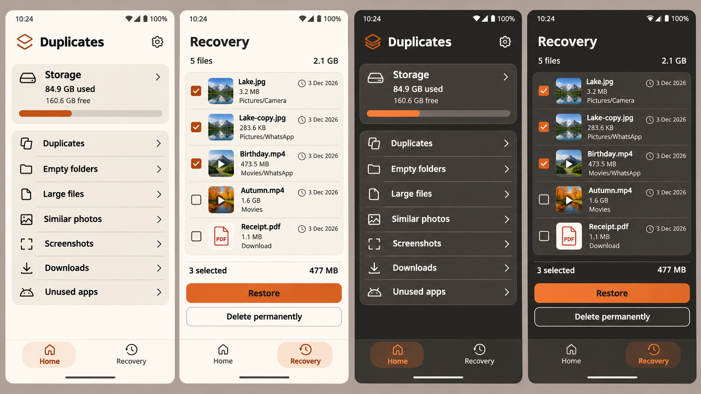
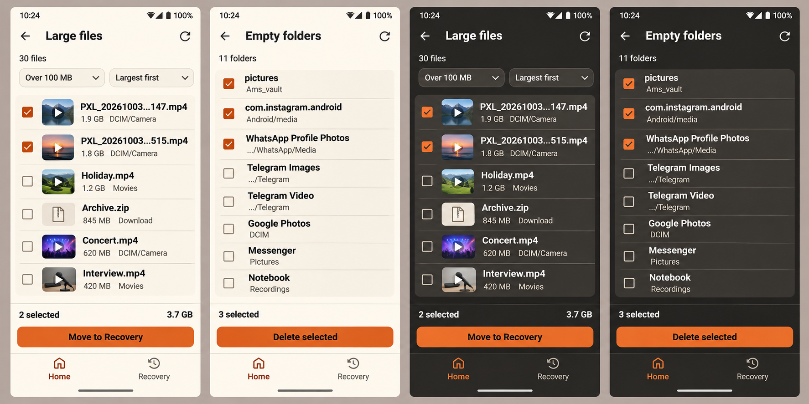
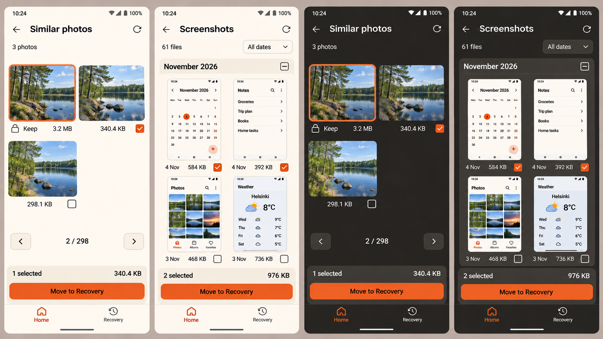
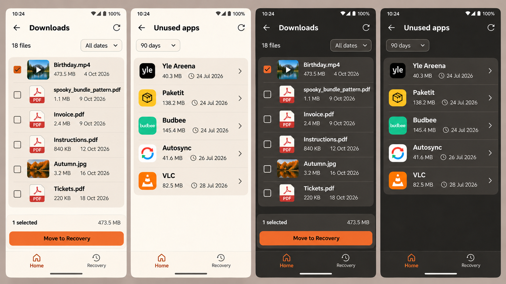

# Duplicates: Home–Recovery-käyttöliittymän toteutussuunnitelma

> **For agentic workers:** Toteuta suunnitelma tehtävä kerrallaan käyttäen `superpowers:executing-plans`-taitoa. Tehtävien seuranta käyttää `- [ ]`-merkintöjä. Tämä dokumentti on suunnitelma, ei lupa aloittaa toteutusta tässä suunnittelutehtävässä. Älä tee commitia, pushia tai PR:ää ilman erillistä käyttäjän pyyntöä; PR:n luo aina käyttäjä.

**Goal:** Toteuta hyväksyttyjen neljän vertailukuvan mukainen käyttöliittymä: vain Home- ja Recovery-välilehdet, kaikki seitsemän työkalua Homessa, tiiviit tuloslistat ja kuvien käsittely sekä toimiva Recovery-monivalinta, palautus ja pysyvä poisto.

**Architecture:** Säilytä nykyinen Jetpack Compose / Material 3 -rakenne, Navigation Compose -reititys, ViewModel/Flow-tilanhallinta, Room-tulosvarasto ja olemassa olevat skannaus- ja poistokoordinaattorit. Muuta nykyisiä näkymiä ja niiden pieniä yhteisiä komponentteja; lisää vain Recovery-esitystila ja kuukausivalinnan tarvitsema erävalinta. Recoveryn uusi poistotoiminto käyttää nykyistä operaatiolukkoa ja poistaa vain tunnistettujen palautuskopioiden omia payload-tiedostoja.

**Tech Stack:** Tarkastettu 4.11.2026: Kotlin 2.4.21, AGP 9.5.0, Compose BOM 2026.09.00, Navigation Compose 2.10.2, Room 2.8.5 / skeema 5, Coil 3.6.3, WorkManager 2.12.0, Coroutines 1.11.0. `minSdk=30`, `compileSdk=37`, `targetSdk=37`, JVM-toolchain 17. Versiot ovat nykytilan kuvaus, eivät päivitysehdotus.

**Spec:** Käyttäjän hyväksymät kuvat K1–K4 jäljempänä sekä tämän dokumentin kohdat 1–7. Käyttäjän viimeisimmät ohjeet ovat ensisijaisia: mahdollisimman tarkka kuvavastaavuus, vain Home ja Recovery, kaikki työkalut Homessa, ei selittäviä ohjetekstejä.

**Tarkastettu lähtötilanne:** Haara `codex/results-selection-clarity`, HEAD `2d54a73505b825365d3e5a5ad7fbaeb0a19973cb`. Työpuu oli puhdas ennen tämän suunnitelman ja vertailukuvien lisäämistä. Lähdetiedostot tarkastettiin Sonarin secrets-skannerilla ennen lukemista. Suunnitteluvaiheessa ei ajettu Gradlea, emulaattoria tai tiedostojen poistotoimintoja.

## Global Constraints

- Sovelluksessa on täsmälleen kaksi päävälilehteä: `Home` ja `Recovery`.
- Home näyttää kaikki seitsemän työkalua. Erillinen Tools-näkymä, Tools-välilehti ja näkyvä Tools-väliotsikko poistuvat.
- Normaaleihin näkymiin ei lisätä ohjeita, perusteluita, vinkkejä, turvallisuusproosaa, opastusta tai uusia ilmoituslaatikoita.
- Erityisesti tekstiä `Files stay in Recovery for at least 30 days and still use storage.` tai vastaavaa ei lisätä.
- Lyhyet toimintonimet, tiedostotiedot, tilamäärät, välttämättömät virhetilat ja pysyvän poiston yksiselitteinen vahvistus säilyvät. Ne eivät saa kasvaa selityskappaleiksi.
- Käyttöliittymätekstit pysyvät englanniksi kuten kuvissa. Lähdekoodin tunnisteet, tiedostonimet ja kommentit ovat englanniksi.
- Ei piste-, pallo- tai ympyräerottimia arvojen väliin. Erota tiedot välilyönneillä, sarakkeilla tai riveillä. Ei koristeellisia värillisiä pystyraitoja.
- Molemmat teemat toteutetaan. 320 dp, 200 % fonttiskaala ja niiden yhdistelmä kuuluvat hyväksyntään.
- Ei riippuvuus-, SDK-, tietokanta-, DI- tai navigaatiokirjaston migraatiota. Ei uusia käyttöoikeuksia, verkkoyhteyttä tai analytiikkaa.
- Säilytä tarkan duplikaattivertailun, samankaltaisuusalgoritmin, skannausrajausten, tiedostojen tunnistamisen, palautusajan ja alkuperäisten tiedostojen suojauksen nykyinen toiminta.
- Käyttöliittymän koot ovat dp/sp-arvoja. Älä skaalaa koko sovellusta kuvaksi tai ohita järjestelmän fonttiskaalaa.
- Säilytä käyttäjän muutokset. Tarkista haara ja työpuu uudelleen toteutuksen alussa. Suojatulla integraatiohaaralla luo ensin `codex/`-ominaisuushaara.
- Kuvien sisältö, päivämäärät, määrät, valinnat, sovellusikonit ja tiedostonimet ovat esimerkkiaineistoa. Tuotannossa ne tulevat oikeasta datasta.

## Review Focus

| Riskitapaus | Odotettu toiminta | Tehtävä ja todistus |
| --- | --- | --- |
| Recovery-tallennus poistuu käytöstä tai polku vaihtuu symlinkiksi | Ei poisteta alkuperäistä, ulkopuolista tiedostoa tai epävarmaa tietokantariviä | T8: repository-testit ja eristetty laitetesti |
| Osittainen monipalautus/-poisto, kaksoisnapautus tai keskeytys | Vain onnistuneet valinnat tyhjenevät; epäonnistuneet säilyvät; operaatio ei käynnisty kahdesti | T9: ViewModel-testit |
| Kuukausivalinta rajatussa kuvakaappauslistassa | Muuttuvat vain juuri näkyvään kuukauteen kuuluvat kelvolliset kohteet; piilovalinnat säilyvät | T6: Room- ja UI-testit |
| Pitkä tiedostonimi, suuri tavumäärä ja 320 dp / 200 % yhdessä | Toiminto ja kokoyksikkö näkyvät; nimi lyhenee hallitusti ja on saatavilla kokonaan | T4, T6, T9, T10: asettelu- ja semantiikkatestit |
| Välilehden vaihto, takaisinpainike tai tallennetun vanhan Tools-reitin palautus | Käyttäjä pääsee Homeen; skannaus ei peruunnu; Tools-ruutua ei synny | T1: navigaation integraatiotestit |

---

## 1. Hyväksytyt vertailukuvat

Nämä ovat **juuri keskustelussa hyväksytyt lopulliset kuvat**, kopioituina muuttamattomina projektin dokumentaatioon. K3 ja K4 ovat korjatut loppuversiot. Niiden aiempia luonnoksia ei käytetä.

Jokaisessa kuvassa on neljä paneelia vasemmalta oikealle: ensimmäinen näkymä vaaleana, toinen näkymä vaaleana, ensimmäinen tummana, toinen tummana.

### K1: Home ja Recovery



### K2: Large files ja Empty folders



### K3: Similar photos ja Screenshots



### K4: Downloads ja Unused apps



### Kuvien alkuperä ja eheys

Alkuperäinen hakemisto: `C:\Users\EmmaH\.codex\generated_images\01a1a5e2-594d-7380-b1b4-fcd7cd249b6a`.

| Tunnus | Alkuperäinen tiedosto | Projektikopion SHA-256 |
| --- | --- | --- |
| K1 | `exec-27b04cdf-e9b4-486e-adde-dc47ff895588.png` | `6B04009C7870DD40204D6753C8CCA45556D55F84D653161EA2199E5D1B547E00` |
| K2 | `exec-c1b2c5d2-c78b-4c09-9a76-aded62ee7021.png` | `E16FD72A28B9C3FC573AD112D39D98D19FB283AD1142EFE2A651962970A85EE9` |
| K3 | `exec-d865eb8a-bac0-499f-8cca-9b8da99e3d9d.png` | `9D525BB2673E529854F07213663FA64E7F54FCABB68184F93DF2E0C6C7356665` |
| K4 | `exec-ad8fc326-f2df-452a-a55c-ad95ca468413.png` | `DB79CA2B93939B133A7FB5319AFDBDD8762BCF81D004FA569232072343BF2524` |

### Visuaalisten tulkintojen tärkeysjärjestys

1. Käyttäjän nimenomaiset ohjeet.
2. Näkymän oma lopullinen K1–K4-paneeli: rakenne, järjestys, tiheys, kuvien paikka ja toimintojen paikka.
3. Tämän suunnitelman yhteiset mitat ja toimintamäärittelyt.
4. Nykyiset komponentit siltä osin kuin ne eivät muuta tavoiteltua ulkonäköä.

Kuvat ovat kuvageneraattorin tuottamia suunnittelukuvia. Niiden epätasaisia kirjainmuotoja, näennäistä pintakohinaa, tahattomia liukuvärejä tai virheellisiä kalenterin pikkunumeroita ei kopioida. Sovelluksen omat tasaiset väripinnat, aidot asennettujen sovellusten ikonit ja järjestelmän tilapalkki säilyvät. PDF-ikoniksi riittää selkeä nykyiseen ikoniperheeseen sopiva PDF-tiedostomerkki; kuvassa näkyvää Acrobatin tuotemerkkiä ei lisätä uutena resurssina.

## 2. Varmennettu nykytila ja muutosten rajaus

| Nykyinen omistaja | Varmennettu lähtökohta | Suunniteltu muutos |
| --- | --- | --- |
| `ui/tools/RootTab.kt` | HOME, TOOLS, RECOVERY | HOME ja RECOVERY |
| `app/AppNavigation.kt`, `app/AppNavigationActions.kt` | Työkalut korostavat Tools-välilehteä; ToolsRoute näyttää oman listan | Kaikki työkalut kuuluvat Homeen |
| `ui/tools/ToolsScreen.kt` | DashboardScreen ja ToolsScreen kutsuvat samaa ToolList-funktiota | Säilytä DashboardScreen ja yksi työkalulista; poista erillinen näkyvä ToolsScreen |
| `ui/tools/ToolResultsScreen.kt` | Otsikko on listassa; yhteenveto näyttää työkalusta riippuen kappaleita tai tavuja | Tiivis otsikko, yhtenäinen valintayhteenveto, kokoleveä painike |
| `ui/tools/ToolItemCards.kt` | Tiedostot ovat erillisiä kortteja; kuvissa Crop; kuvakaappauksen valinta kuvan päällä | Ryhmitellyt rivit, kokonaiset vertailukuvat, kuvakaappausten alapuoliset valinnat |
| `ui/tools/ToolFilters.kt` | Suuri tallennusaluepainike, ylhäällä ryhmänvaihto, All / 6 kk / 1 v | Kuvien mukaiset lyhyet suodattimet; ryhmänvaihto alas |
| `app/ToolViewModel.kt`, `ToolResultsState.kt` | Tallentamaton kuukausisuodatin on 6 | Uuden näkymän oletus All dates eli 0; olemassa oleva tallennettu valinta säilyy |
| `data/ToolResultStore.kt` | Yksittäinen valinta ja säilytettävän kuvan vaihto ovat transaktioita | Lisäksi vain Screenshotsin tarvitsema rajattu erävalinta |
| `ui/settings/RecoveryScreen.kt` | Polku, palautusaika ja yksi Restore copy -painike per rivi | K1:n lista, esikatselut, määrät, monivalinta ja kaksi alapainiketta |
| `app/RecoveryViewModel.kt` | Yksittäinen palautus; jaettu mutex ja cleanupIdle-tarkistus | Eräpalautus, poistovahvistuksen snapshot, eräpoisto ja lyhyt tulostila |
| `data/RecoveryRepository.kt` | Sama levy, payload, 30 päivän säilytys; restore kopioi ja jättää payloadin | Turvallinen metatietojen luku ja valittujen payloadien pysyvä poisto |
| `core/database/RecoveryFile.kt` | id, originalPath, storedPath, createdAt, expiresAt | Skeema säilyy; koko ja esikatselun kelpoisuus johdetaan olemassa olevasta payloadista |
| `ui/tools/UnusedAppsScreen.kt` | Suuret erilliset kortit ja toistuva Open app details | Yhtenäinen kompakti, kokonaan avattava rivistö |
| `ui/preview/PreviewScreens.kt`, `app/ToolPreviewViewModel.kt` | Kuvan zoomaus ja säilytettävän vaihto ovat jo olemassa | Käytä nykyistä toimintoa; älä rakenna uutta vertailumoottoria |

Taulukon lähdepolut ovat suhteessa `app/src/main/java/com/emma/duplicates/`.

Tarkan duplikaattihaun asetukset, tulokset ja skannausnäkymä sekä Storage usage ja asetukset eivät saa uutta sisäistä ulkoasua tässä työssä: niille ei hyväksytty uutta kuvapaneelia. Niiden reitit, kahden välilehden kuuluminen ja yhteisten komponenttien regressiot tarkistetaan. Näin kaikkien hyväksyttyjen kuvien toteutus ei laajene koko sovelluksen uusimiseksi.

## 3. Yhteinen ulkoasusopimus

### 3.1 Värit ja pinnat

| Rooli | Vaalea | Tumma |
| --- | --- | --- |
| Tausta | `#FFFCF2` | `#252422` |
| Ryhmitellyn listan / kortin pinta | `#F0EBE1` | `#403D39` |
| Pääteksti | `#252422` | `#FFFCF2` |
| Toissijainen teksti | `#625E58` | `#CCC5B9` |
| Erotin | `#D8D2C7` | `#57534D` |
| Ensisijaisen painikkeen täyttö | `#EB5E28` | `#EB5E28` |
| Täytetyn painikkeen teksti | `#252422` | `#252422` |
| Valitun välilehden / pienen tekstitoiminnon väri | nykyinen `#AD3C12` | `#EB5E28` |

Nykyinen `#AD3C12` on lähellä hyväksytyn kuvan tummaa oranssia ja käytössä RootNavigationBarissa; siirrä se nimetyksi väritokeniksi `LightActionText`, älä lisää lähes identtistä kilpailevaa oranssia. Valintaruutujen vaalea täyttö käyttää tummaa oranssia ja valkoista rastia; tummassa teemassa kirkasta oranssia ja tummaa rastia. Mittaa parien kontrastit.

K1:n päävälilehtinäkymissä aktiivisen välilehden takana on matala oranssi sävypinta. K2–K4:n työkalunäkymissä aktiivinen Home osoitetaan värillä ilman taustapilleriä. Toteuta tämä samassa RootNavigationBarissa yhdellä `emphasizeSelection`-parametrilla: true HomeRoute/RecoveryRoute, false alireiteillä. Molempien tabien leveys ja sijainti ovat aina samat.

### 3.2 Mitat ja tekstihierarkia

Nämä ovat toteutuksen täsmälliset aloitusarvot. Säädä niitä vain, jos kohdan 10 kuvavertailu osoittaa tarpeen; kirjaa poikkeama samassa dokumentissa, älä tee vaihtoehtoista omaa redesignia.

| Elementti | Aloitusarvo ja käyttäytyminen |
| --- | --- |
| Näkymän vaakareuna | 16 dp; sisältö asettuu samoihin reunoihin otsikon ja alapalkin kanssa |
| Otsikkorivi | vähintään 56 dp, otsikko 22 sp / 28 sp, SemiBold; kasvaa tarvittaessa |
| Home-otsikko | 26 sp / 32 sp, SemiBold; nykyinen pinoikoni ja asetusratas |
| Rivin nimi | 16 sp / 22 sp, SemiBold |
| Rivin metadata | 14 sp / 20 sp; koko ei päädy näkymättömäksi tai katkaistuksi |
| Kuvakortin metadata | 14 sp / 20 sp; suurella fontilla koko ja valinta voidaan jakaa riveille |
| Home-työkalurivi | vähintään 56 dp, 16 dp sivupadding, 24 dp ikoni, 12 dp väli |
| Tiedosto-/kansiorivi | vähintään 72 dp; padding pystysuunnassa 8 dp, kasvaa tekstin mukana |
| Recovery-/sovellusrivi | vähintään 88 dp; kasvaa tarvittaessa |
| Tiedostopikkukuva | 48 dp, enintään 8 dp kulmapyöristys; videossa toistokuvake |
| Sovellusikoni | 48 dp, käytä oikean sovelluksen ikonia |
| Ryhmitelty listapinta | 16 dp ulkokulmat; ei 12–16 dp rakoja jokaisen tiedostorivin väliin |
| Rivien erotin | 1 dp, sisennetty tekstialueeseen kun rivillä on ikoni/pikkukuva |
| Kuvien väli | 12 dp; kaksi palstaa tavallisessa leveydessä |
| Similar photos -kuva-alue | neliö 1:1; `ContentScale.Fit`, ei käyttäjän kuvan rajaamista |
| Screenshots -kuva-alue | tavallisen puhelimen lähtökorkeus 208 dp; koko kuva Fit-tilassa, keskitettynä; metatiedot ja valinta erillisessä vähintään 48 dp rivissä |
| Ensisijainen painike | koko sisältöleveys, vähintään 48 dp korkea, 12 dp kulmat, 16 sp SemiBold |
| Alapalkki | 16 dp vaakapadding; yhteenveto, 8 dp väli, painike; ei suurta tyhjää yläpaddingia |
| Päävälilehdet | vähintään 72 dp + järjestelmän alainset; 24 dp ikoni, 14 sp nimi; kaksi yhtä leveää kohdetta |
| Kosketusalue | vähintään 48 × 48 dp, vaikka näkyvä checkbox tai ikoni on pienempi |

Älä muuta koko sovelluksen `bodyMedium`-tyyliä pienemmäksi. Käytä näissä tiiviissä metatiedoissa nykyistä `bodySmall`-roolia tai yhteistä rajattua tyyliä. Yhteisten rivien hierarkia ei saa muuttaa vanhojen duplikaattitulosten luettavuutta vahingossa.

### 3.3 Pitkät nimet ja skaalautuminen

- Normaali tiedostorivi: nimi yksi rivi, hallittu keskiellipsi; tiedostopääte jää näkyviin. Ei kiinteää merkkimäärään perustuvaa katkaisua.
- Kansiorivi: nimi voi käyttää kaksi riviä kapealla leveydellä; polku yksi toissijainen rivi. Lyhennä polun alku, säilytä viimeiset tunnistettavat kansiotasot.
- Täysi nimi ja polku ovat edelleen olemassa olevassa tiedosto-/kansioesikatselussa ja saavutettavassa nimessä. Lyhennys ei muuta toiminnon kohdetta.
- Painikkeiden nimiä, kokoyksiköitä, määriä tai päivämääriä ei ellipsoida. Tarvittaessa vaihda sarakkeista riveihin.
- Säilytä nykyinen yhden kuvapalstan ehto: leveys alle 360 dp tai fonttiskaala vähintään 1,5. Tämä kattaa 320 dp:n ja 200 %:n yhdistelmän.
- Tavallisessa korkeudessa otsikko, valintatoiminnot ja välilehdet ovat saavutettavissa listan vierityksestä riippumatta. Alle 360 dp käytettävissä olevassa korkeudessa toimintopalkki saa siirtyä listan loppuun, kuten nykyinen lyhyen ruudun ratkaisu.
- Suuri fontti saa kasvattaa rivejä ja vähentää kerralla näkyvää sisältöä. Älä pienennä fonttia pakottaaksesi vertailukuvan rivimäärän.
- Sovella järjestelmän ylä- ja alainset vain kerran. Testaa ele- ja kolmen painikkeen navigointi.

## 4. Näkymäkohtainen tarkka toteutus

### 4.1 Home — K1, paneelit 1 ja 3

1. Yläreunassa nykyinen pinoikoni, `Duplicates` ja asetusratas. Ei takaisin-nuolta.
2. Kompakti Storage-kortti: ikoni, `Storage`, oikea chevron, käytetty tila muodossa `%s used`, vapaa tila muodossa `%s free`, ohut käyttöastepalkki.
3. Koko Storage-kortti avaa nykyisen Storage usage -reitin. Poista erillinen `View storage usage`-tekstipainike.
4. Yksi ryhmitelty työkalulista tässä järjestyksessä: `Duplicates`, `Empty folders`, `Large files`, `Similar photos`, `Screenshots`, `Downloads`, `Unused apps`.
5. Jokaisessa rivissä ikoni, nimi ja chevron. Ei kuvauksia, työkalukohtaisia mittareita tai Tools-väliotsikkoa.
6. Näytä 411 dp / 100 % -vertailussa kaikki seitsemän työkalua ennen alapalkkia. Pienemmässä/korkealtaan rajoitetussa näkymässä lista vierii.
7. Jos tallennustilaa ei tunneta, näytä `—`; älä piirrä tekaistua prosenttia. Nykyinen käyttöoikeuden myöntämistoiminto säilyy tarvittavassa poikkeustilassa.

### 4.2 Recovery — K1, paneelit 2 ja 4

1. Otsikko on `Recovery`, ilman takaisin-nuolta koska kyse on päävälilehdestä.
2. Yhteenveto: tiedostomäärä vasemmalla, kokonaiskoko oikealla. Tuntemattomia kokoja sisältävä summa näytetään `—`, ei harhaanjohtavana osasummana.
3. Ryhmitellyn rivin järjestys: checkbox, 48 dp pikkukuva/tiedostokuvake, tiedostonimi, koko, lyhyt alkuperäinen kansio; oikealla kellokuvake ja vanhenemispäivä.
4. Vanhenemispäivä on K1:n mukaan esimerkiksi `3 Dec 2026`, ilman `Recover before`-lausetta. `expiresAt=null` näytetään `—`; TalkBack-nimi kertoo lyhyesti, ettei vanhenemispäivää ole.
5. Päälistassa ei näytetä `/storage/emulated/0/`-alkua eikä payload-polkuja.
6. Rivi tai checkbox muuttaa samaa valintaa kerran. Pikkukuva on tunnistamista varten; tähän työhön ei lisätä uutta Recovery-esikatselureittiä tai payloadin ulkoista jakamista.
7. Alapalkki: `%d selected` vasemmalla, valittujen yhteiskoko oikealla; kokoleveä `Restore`; sen alla kokoleveä reunuksellinen `Delete permanently`.
8. Nollavalinnassa molemmat toiminnot ovat disabled, yhteenveto `0 selected`, valittu koko `0 bytes`. Ei `Select files...`-ohjetta.
9. `Restore` palauttaa valitut nykyisellä kopioivalla toteutuksella. Palautuskopio säilyy nykyisen toimintatavan mukaisesti. Älä muuta tätä siirroksi tai aikaista vanhenemista.
10. `Delete permanently` näyttää lyhyen vahvistuksen: otsikko `Delete permanently?`, sisältö tiedostomäärä ja koko, painikkeet `Cancel` ja `Delete permanently`. Poista vain vahvistuksen hetkellä talteen otetut id:t. Vahvistus tarvitaan myös, jos tavallisen palautukseen siirron vahvistus on asetuksista pois päältä.
11. Operaation aikana valinta ja toimintopainikkeet ovat pois käytöstä. Näytä pieni progress-elementti samassa toimintopalkissa, ei uutta selittävää tekstikorttia.
12. Onnistumispalaute on lyhyt: `Restored %d` tai `Deleted %d`. Osittainen tulos: `Restored %d, failed %d` / `Deleted %d, failed %d`. Virheelliset valinnat säilyvät uusintaa varten.

### 4.3 Large files — K2, paneelit 1 ja 3

- Yksi otsikkorivi: takaisin, `Large files`, refresh.
- Tulosmäärä `30 files`-muodossa. Sen alla nykyiset koko- ja järjestysvalinnat; aloitus `Over 100 MB` ja `Largest first`.
- Säilytä nykyiset rajat: 100 MB, 500 MB, 1 GB; suuruusraja on aidosti suurempi kuin valittu raja. Säilytä muut nykyiset järjestysvaihtoehdot.
- Ryhmitelty tiivis lista: checkbox, pikkukuva/tiedostokuvake, nimi ja seuraavalla rivillä koko sekä lyhyt kansio.
- Esikatselu ja valinta ovat eri kohteet; rivin tekstin/pikkukuvan napautus ei valitse poistettavaa.
- Alapalkki näyttää aina määrän ja koon; alla kokoleveä `Move to Recovery`.
- Ei tallennusaluepillereitä tai normaalitilan `Skipped`-riviä.

### 4.4 Empty folders — K2, paneelit 2 ja 4

- Otsikko `Empty folders`, takaisin ja refresh; lyhyt `%d folders`-määrä.
- Yhtenäinen lista: checkbox, kansion nimi, lyhyt suhteellinen polku. Poista jokaisella rivillä toistuva suuri kansioikoni.
- Säilytä kansiodialogi täydelle polulle tekstialuetta napautettaessa.
- Säilytä vanhempi/lapsi-valinnan nykyiset säännöt: vanhemman valinta valitsee kelvolliset jälkeläiset; lapsen valinnan poisto purkaa riippuvat vanhempivalinnat.
- Alapalkissa vain `%d selected` ja `Delete selected`, ei tavumäärää.
- Poisto on edelleen erillinen hakemistokohtainen, ei-rekursiivinen operaatio. Uusi listailme ei saa muuttaa sitä tiedostojen poistoksi.

### 4.5 Similar photos — K3, paneelit 1 ja 3

- Otsikko `Similar photos`, takaisin ja refresh. Lyhyt nykyisen ryhmän kuvamäärä, esimerkiksi `3 photos`.
- Kaksi palstaa normaalileveydessä, kuvat Fit-tilassa. Ei kansiopillereitä tai koko kuvan päälle asetettuja Keep-merkkejä.
- Säilytettävä kuva ensin: 2 dp oranssi reunus, kuvan alapuolella lukko, `Keep` ja koko. Sillä ei ole poistovalinnan checkboxia.
- Muilla kuvilla alarivissä koko vasemmalla ja checkbox oikealla. **Niiden yhteydessä ei saa näkyä Keep-sanaa.** K3:n lopullinen korjattu versio on tästä määräävä.
- Kuvan napautus avaa olemassa olevan esikatselun. Säilytettävä vaihdetaan siellä nykyisellä toiminnolla; älä lisää riveille Keep-painikkeita tai valintaperusteluita.
- Edellinen/seuraava-ryhmä ja `2 / 298`-laskuri siirtyvät alas juuri valintapalkin yläpuolelle. Ei samaa ryhmänvaihtoa kahdessa paikassa.
- Ryhmää vaihdettaessa uuden ryhmän lista alkaa alusta; aiempien ryhmien valinnat säilyvät nykyiseen tapaan. Alapalkin määrä ja koko kattavat kaikki tämän tulosjoukon valinnat.
- Jos valintoja on muissa ryhmissä, nykyinen lyhyt piilovalintamäärä saa näkyä lisärivillä. Se on toiminnon kohdetieto, ei opastus. Sitä ei näytetä nollatilassa.
- Älä lisää automaattivalintaa, `Select others`-toimintoa tai uutta vertailualgoritmia: niitä ei ole hyväksytyssä kuvassa.

### 4.6 Screenshots — K3, paneelit 2 ja 4

- Otsikko `Screenshots`, takaisin, refresh; määrä ja `All dates` -suodatin kompaktisti.
- Säilytä kuuden kuukauden ja vuoden vaihtoehdot; oletus uudessa tilassa on All dates.
- Kuukausiotsikko, esimerkiksi `November 2026`, sekä oikealla kolmitilainen kuukausivalinta.
- Kaksi palstaa normaalileveydessä. Jokainen kuvakaappaus näytetään kokonaan Fit-tilassa: ei nykyistä leveää keskikohdan rajausta.
- Kuvan alapuolella lyhyt päivä (`4 Nov`), koko (`584 KB`) ja checkbox. Ei peittävää valintalaattaa kuvan päällä.
- Kuukausivalinta on Off, kun mikään kuukauden näkyvistä kelvollisista kohteista ei ole valittu; On, kun kaikki ovat valittuja; Indeterminate muulloin. Off/Indeterminate valitsee kaikki kyseisen näkyvän kuukauden kohteet, On poistaa vain niiden valinnat.
- Muut kuukaudet ja suodattimen taakse jääneet valinnat eivät muutu kuukausivalinnasta. Uusi tulosajo ei peri vanhan ajon valintoja.
- Käytä tallennetun skannauksen aikavyöhykettä ryhmittelyssä kuten nyt. Tuntematon/tuleva päivämäärä pysyy nykyisen rajauksen mukaisesti All dates -näkymässä omana `Unknown date` -ryhmänään.
- Näytetyt valittujen koot lasketaan todellisista tavuista. K3:n esimerkin 584 KB + 392 KB = 976 KB.
- Alapalkki: määrä ja koko, kokoleveä `Move to Recovery`.

### 4.7 Downloads — K4, paneelit 1 ja 3

- Otsikko `Downloads`, ei `Old downloads` eikä ylimääräistä `Duplicates`-otsikkoa.
- Sisäinen `CleanupTool.OLD_DOWNLOADS`-arvo ja tallennetut työkalutunnisteet pysyvät ennallaan; muuta näkyvä teksti, älä migroi tuloksia.
- Määrä ja `All dates`; sama ikäsuodatus kuin Screenshotsissa, uusi oletus 0 kuukautta.
- Ryhmitelty lista: checkbox, pieni tiedostolajin kuvake/esikatselu, nimi, koko ja päivämäärä `4 Oct 2026`. Käytä nykyistä `modifiedAt`-arvoa; älä keksi erillistä latausajankohtaa.
- Videossa toistokuvake; PDF:ssä yksinkertainen PDF-tiedostomerkki. APK säilyy tavallisena tiedostona eikä koskaan käynnistä asennusta.
- K4:n korjatun version mukaan valintayhteenveto on omalla rivillään ja `Move to Recovery` sen alla **kokoleveänä**, ei pienenä sivupainikkeena.

### 4.8 Unused apps — K4, paneelit 2 ja 4

- Otsikko `Unused apps`, takaisin ja refresh. Ei ylimääräistä Duplicates-otsikkoa.
- Suodatin `90 days`; vaihtoehdot 30, 90 ja 180 päivää. Säilytä nykyinen 90 päivän oletus ja kelpoisuuslogiikka.
- Ryhmitelty lista: oikea sovellusikoni, nimi, koko, kellokuvake ja lyhyt viimeisen käytön päivämäärä, oikealla chevron.
- Koko rivi avaa nykyisen sovelluskohtaisen Android App info -näkymän. Poista toistuva `Open app details`-tekstipainike.
- Ei valintaruutuja, valintapalkkia tai sovellusten massapoistoa.
- Tuntematon koko on `—`. Puuttuva käyttöhistoria ei tee sovelluksesta käyttämätöntä. Käyttöoikeuden myöntäminen, peruminen ja palaaminen asetuksista säilyvät.

## 5. Tekstien ja tilojen sopimus

| Tilanne | Näkyvä teksti / toiminto |
| --- | --- |
| Päävälilehdet | Home, Recovery |
| Normaali toiminto | Restore, Delete permanently, Delete selected, Move to Recovery |
| Ei tuloksia | No files / No folders / No apps kyseisen näkymän mukaan |
| Tyhjä Recovery | No files; toimintopainikkeet disabled |
| Tuntematon koko tai päivämäärä | —, ei 0:n keksimistä |
| Käyttöoikeus puuttuu | Access required tai Usage access required ja Grant access |
| Skannaus | Progress sekä lyhyt Scanning / Comparing photos ja Cancel |
| Todellinen skannausvirhe | Lyhyt Scan failed; refresh toimii, ei virheen peittämistä tyhjänä tuloksena |
| Osittainen skannaus | Partial scan; älä esitä kattavana tuloksena |
| Tavallisen siirron vahvistus | Move to Recovery? + määrä ja koko + Cancel / Move to Recovery |
| Pysyvä poisto | Delete permanently? + määrä ja koko + Cancel / Delete permanently |
| Piilovalinnat | Nykyinen lyhyt lukumäärätieto vain, kun piilovalintoja todella on |

Normaalin onnistuneen skannauksen yleinen `Skipped: N`-rivi ja suuri tallennusaluepainike poistuvat näistä työkalunäkymistä. Skannausalue asetetaan edelleen nykyisissä asetuksissa; taustalla oleva scope ja poissulut eivät laajene. Ohitetun määrän sisäinen tallennus säilyy. Älä piilota todellista epäonnistunutta tai osittaista skannausta.

Lyhennä tähän työnkulkuun kuuluvat pitkät vahvistus- ja onnistumistekstit. Älä aloita kaikkien asetusten ja käyttöoikeusnäkymien erillistä tekstiuudistusta. Kaikki uudet tekstit tulevat string/plural-resursseista. TalkBack-kuvaukset voivat olla täsmällisempiä kuin näkyvät tekstit; niitä ei tulosteta ruudulle.

## 6. Tiedostokartta

Alla pääpolku `M` tarkoittaa `app/src/main/java/com/emma/duplicates/`, `T` vastaavasti `app/src/test/java/com/emma/duplicates/` ja `A` `app/src/androidTest/java/com/emma/duplicates/`.

| Vastuu | Muokattavat / uudet tiedostot |
| --- | --- |
| Pääreititys | `M/app/AppNavigation.kt`, `M/app/AppNavigationActions.kt`, `M/app/Routes.kt`, `M/ui/tools/RootTab.kt`, `M/ui/tools/RootNavigationBar.kt` |
| Home | `M/ui/tools/ToolsScreen.kt` (nimi saa säilyä pienimmän muutoksen vuoksi), tarvittaessa `M/ui/components/ScreenComponents.kt` vain HomeHeaderin rajattuun muutokseen |
| Rajatut yhteiset ulkoasuroolit | `M/core/designsystem/Color.kt`, `Components.kt`, `Type.kt`, `Theme.kt`; muuta vain tehtävän käyttämät roolit |
| Tulosten runko ja rivit | `M/ui/tools/ToolResultsScreen.kt`, `ToolItemCards.kt`, `ToolFilters.kt`, `ToolResultsState.kt`, `M/app/ToolDestinations.kt` |
| Päivämäärät ja media | `M/core/format/DisplayFormatters.kt`, `M/ui/components/MediaThumbnail.kt` |
| Kuukausivalinta ja oletussuodatus | `M/app/ToolViewModel.kt`, `M/data/ToolResultStore.kt`; käytä olemassa olevaa ToolDao.updateItems-operaatiota |
| Unused apps | `M/ui/tools/UnusedAppsScreen.kt`; repositoryn kelpoisuussääntöjä ei muuteta |
| Recovery-data | `M/data/RecoveryRepository.kt`; **uusi** `M/data/RecoveryEntry.kt` vain kuvaamaan payloadista luettua esitystietoa |
| Recovery-tila ja näkymä | `M/app/RecoveryViewModel.kt`, `M/app/RecoveryDestination.kt`, `M/ui/settings/RecoveryScreen.kt`; **uusi** `M/ui/settings/RecoveryUiState.kt` |
| Resurssit | `app/src/main/res/values/strings.xml`, `tool_strings.xml`; olemassa oleva ikonikansio vain, jos PDF-tunnistetta ei voi toteuttaa nykyisellä kuvakkeella ja lyhyellä PDF-tekstillä |
| Olemassa olevat testit | `T/app/AppNavigationTest.kt`, `ToolNavigationTest.kt`, `ToolViewModelTest.kt`, `ToolPreviewViewModelTest.kt`, `T/ui/ToolsLayoutTest.kt`, `ToolResultsStateTest.kt`, `settings/RecoveryScreenTest.kt`, `T/data/ToolResultStoreTest.kt`, `RecoveryRepositoryTest.kt`, `T/core/designsystem/DuplicatesThemeTest.kt`, `T/core/format/DisplayFormattersTest.kt`, `T/ToolStringResourcesTest.kt` |
| Uusi rajattu testi | **uusi** `T/app/RecoveryViewModelTest.kt`, koska eräoperaatioiden tilanhallinnalle ei ole nykyistä omaa testiluokkaa |
| Laitetestit | `A/RecoveryStorageTest.kt`, `A/core/storage/StorageCleanupDeviceTest.kt` |
| Dokumentaatio toteutuksen lopuksi | `README.md`, tämän suunnitelman toteutus-/tarkistusruudut ja lyhyt tulostaulukko kohdassa 11 |

Älä luo yleistä listarakentajaa, uutta design system -moduulia, repository-rajapintakerrosta tai yleiskäyttöistä eräoperaatiokehystä. Ryhmitellyn rivin ulkokulmat ja erotin voidaan toteuttaa olemassa olevan tiedoston pienellä paikallisella apufunktiolla. Säilytä listojen lazy-renderöinti.

## 7. Rajapinnat, jotka toteutus lukitsee

Seuraavat ovat **suunniteltuja uusia tai muutettavia rajapintoja**, eivät väite niiden nykyisestä olemassaolosta.

```kotlin
// ui/tools/RootNavigationBar.kt
@Composable
fun RootNavigationBar(
    selected: RootTab,
    onSelect: (RootTab) -> Unit,
    modifier: Modifier = Modifier,
    emphasizeSelection: Boolean = true,
)

// core/format/DisplayFormatters.kt: käytä nykyistä englanninkielistä muotoilulinjaa.
fun date(epochMillis: Long, zoneId: ZoneId = ZoneId.systemDefault()): String // d MMM yyyy
fun shortDate(epochMillis: Long, zoneId: ZoneId = ZoneId.systemDefault()): String // d MMM

// data/ToolResultStore.kt: uusi operaatio on rajattu Screenshots-työkaluun.
suspend fun setScreenshotSelection(sessionId: String, ids: Set<String>, selected: Boolean)

// app/ToolViewModel.kt: ids muodostetaan kulloinkin näkyvästä kuukaudesta.
fun selectScreenshots(ids: Set<String>, selected: Boolean)

// data/RecoveryEntry.kt: ei Room-entity, ei skeemamuutosta.
data class RecoveryEntry(
    val file: RecoveryFile,
    val sizeBytes: Long?,
    val previewPath: String?,
    val available: Boolean,
)

// data/RecoveryRepository.kt
suspend fun describe(
    records: List<RecoveryFile>,
    ioDispatcher: CoroutineDispatcher = Dispatchers.IO,
): List<RecoveryEntry>
suspend fun deletePermanently(
    id: String,
    ioDispatcher: CoroutineDispatcher = Dispatchers.IO,
): Boolean

// ui/settings/RecoveryUiState.kt
enum class RecoveryAction { RESTORE, DELETE }
data class RecoveryOutcome(val action: RecoveryAction, val succeeded: Int, val failed: Int)
data class RecoveryUiState(
    val entries: List<RecoveryEntry> = emptyList(),
    val selectedIds: Set<String> = emptySet(),
    val busy: Boolean = false,
    val pendingDeleteIds: Set<String>? = null,
    val outcome: RecoveryOutcome? = null,
)

// app/RecoveryViewModel.kt
val state: StateFlow<RecoveryUiState>
fun select(id: String, selected: Boolean)
fun restoreSelected()
fun requestDelete()
fun confirmDelete()
fun dismissDelete()
fun dismissResult()

// ui/settings/RecoveryScreen.kt
@Composable
fun RecoveryScreen(
    state: RecoveryUiState,
    onSelect: (String, Boolean) -> Unit,
    onRestore: () -> Unit,
    onRequestDelete: () -> Unit,
    onConfirmDelete: () -> Unit,
    onDismissDelete: () -> Unit,
    onDismissResult: () -> Unit,
    modifier: Modifier = Modifier,
)
```

`ToolResultsScreen` saa lisäksi `onSelectScreenshots: (Set<String>, Boolean) -> Unit` -callbackin. Sen tarpeeton `onScope`-callback poistuu näkyvän tallennusaluepainikkeen mukana; itse scope-logiikka ja asetusten reitti säilyvät. `ToolImageCard` saa erilliset esitystiedot päivämäärälle vain, jos nykyisten item/state-parametrien välittäminen ei riitä; älä lisää rinnakkaista tiedostomallia.

Recovery-valinta elää nykyisen navigaatioentryn ViewModelissa. Konfiguraatiomuutos ei kadota sitä. Prosessin kuoltua valinta ja pysyvän poiston vahvistus tyhjenevät; kesken jäänyttä tuhoavaa toimintoa ei käynnistetä automaattisesti.

## 8. Toteutustehtävät

### T1. Kaksi päävälilehteä ja työkalujen Home-reititys

**Files:** tiedostokartan pääreititys; testit `AppNavigationTest.kt`, `ToolNavigationTest.kt`.

**Interfaces:** säilytä `openTool(CleanupTool)` ja `selectRootTab(RootTab)`; RootTab sisältää HOME ja RECOVERY. RootNavigationBarin uusi parametri on kohdassa 7.

- [x] Päivitä navigaatiotestit ensin: päävälilehtiä on kaksi, Tools-tabia/-otsikkoa ei ole, kaikki seitsemän työkalua avautuvat Homesta.
- [x] Lisää testit `toolDestinationsBelongToHomeTab`, `recoveryAndHomeSwitchWithoutDuplicateDestinations` ja `legacyToolsRouteReturnsHome`: valittu tab, takaisinpolku ja skannauksen säilyminen varmennetaan, ei pelkkä tekstin löytyminen.
- [x] Poista TOOLS RootTabista ja ToolsScreenin näkyvästä graafikäytöstä. AppNavHost valitsee RECOVERY vain RecoveryRoutelle, muille tabillisille reiteille HOMEn.
- [x] Säilytä serialisoitu `ToolsRoute` vain pienenä vanhan tallennetun reitin yhteensopivuusohjauksena: sen sisältö kutsuu returnHomea eikä piirrä ToolsScreeniä. Älä lisää sille uutta valikkoa tai säilytä kahta työkalulistaa.
- [x] Toteuta kaksi tasaleveää tabia ja K1:n root-korostus. Alireiteillä käytä K2–K4:n väritettyä Home-merkintää.
- [x] Päivitä testi `exactResultsReturnToSetupAndItsToolsOrigin` vastaamaan Home-alkuperää; älä muuta tarkan haun työnkulkua muuten.
- [x] Aja: `.\gradlew.bat :app:testDebugUnitTest --tests "com.emma.duplicates.app.AppNavigationTest" --tests "com.emma.duplicates.app.ToolNavigationTest" --no-daemon --console=plain`.

**Valmis, kun:** koko nykyinen reittigraafi toimii kahdella tabilla; vanha Tools-reitti ei jätä tyhjää ruutua tai riko back stackia.

### T2. Rajatut värit, tyylit ja Home

**Files:** `ToolsScreen.kt`, `RootNavigationBar.kt`, tarpeelliset design system -tiedostot, resurssit; testit `DuplicatesThemeTest.kt`, `ToolsLayoutTest.kt`.

**Interfaces:** säilytä `DashboardScreen(HomeUiState, HomeConfiguration, ...)` ja Storage usage -avaus; käytä nykyistä dataa.

- [x] Lisää Home-asettelutesti: yksi Storage-kortti, yksi seitsemän rivin lista oikeassa järjestyksessä, ei Tools-otsikkoa eikä View storage usage -tekstiä.
- [x] Lisää väritesti `lightActionsAndSelectionMarksMeetContrastTargets`; säilytä nykyiset tumman teeman väritestit.
- [x] Siirrä vaalean teeman nykyinen tumma valintaoranssi nimetyksi tokeniksi. Käytä sitä myös pienissä tekstitoiminnoissa ja vaalean teeman valintaruuduissa.
- [x] Toteuta kompakti Storage-kortti ja koko kortin klikkaus. Käytä todellisia käytetty/vapaa-arvoja ja nykyistä epävarman tilan käsittelyä.
- [x] Muuta ToolList yhdeksi ryhmitellyksi listaksi. Poista tarpeeton ToolsScreen-funktio ja ToolHeading-käyttö, mutta vältä tiedoston uudelleennimeämisestä syntyvää tarpeetonta muutosta.
- [x] Käytä olemassa olevia kuvakkeita ja kohdan 3 mittoja; rajoita mahdollinen HomeHeader-tyylimuutos Homeen.
- [x] Aja: `.\gradlew.bat :app:testDebugUnitTest --tests "com.emma.duplicates.core.designsystem.DuplicatesThemeTest" --tests "com.emma.duplicates.ui.ToolsLayoutTest" --no-daemon --console=plain`.
- [x] Vertaa vaaleaa ja tummaa Homea K1:n paneeleihin 1 ja 3 ennen siirtymistä muiden ruutujen viimeistelyyn.

**Valmis, kun:** Home toimii kuvan mukaisena ainoana työkalujen aloituspaikkana eikä perustu uusiin kovakoodattuihin esimerkkilukuihin.

### T3. Tulosnäkymien runko, tekstit ja valintapalkki

**Files:** `ToolResultsScreen.kt`, `ToolFilters.kt`, `ToolResultsState.kt`, `ToolDestinations.kt`, string-resurssit; testit `ToolResultsStateTest.kt`, `ToolsLayoutTest.kt`, `ToolStringResourcesTest.kt`.

**Interfaces:** sama ToolScreenState ja nykyiset cleanup-callbackit. Uusi screenshots-callback lisätään T6:ssa; muille työkaluille ei lisätä uusia operaatioita.

- [x] Päivitä testit odottamaan kaikilla tiedostotyökaluilla sekä valittua määrää että valittuja tavuja; kansiot näyttävät vain määrän.
- [x] Siirrä DetailHeader kompaktiksi otsikkoriviksi listan yläpuolelle. Älä jätä tyhjää ToolRunStatus-lista-alkiota normaalitilaan.
- [x] Poista normaalitilan Skipped-rivi, scope-pilleri ja niihin varattu tyhjä tila. Säilytä virhe-, partial-, käyttöoikeus- ja skannaustilat lyhyinä.
- [x] Yhtenäistä alapalkki: määrä ja koko samalla rivillä mahdollisuuksien mukaan, sen alla kokoleveä toiminto. Poista työkalukohtainen inline-painikehaara.
- [x] Säilytä `hiddenCount` ja tarvittaessa sen lyhyt lisärivi; siirtovahvistus ei saa unohtaa näkymän ulkopuolisia valintoja.
- [x] Lyhennä tämän työnkulun vahvistus- ja tulostekstit kohdan 5 mukaan. Nykyinen Androidin suostumusdialogi ja käyttäjän confirmBeforeDelete-asetus säilyvät.
- [x] Testaa nollavalinta, skannaus, busy, partial, virhe, ei käyttöoikeutta ja lyhyt maisemanäkymä. Disabled-painikkeen ulkoasu ei saa muistuttaa aktiivista painiketta.
- [x] Aja: `.\gradlew.bat :app:testDebugUnitTest --tests "com.emma.duplicates.ui.ToolResultsStateTest" --tests "com.emma.duplicates.ui.ToolsLayoutTest" --tests "com.emma.duplicates.ToolStringResourcesTest" --no-daemon --console=plain`.

**Valmis, kun:** normaalitila vastaa K2–K4:n tiivistä rakennetta ja poikkeustilat ovat edelleen toimivia.

### T4. Large files, Empty folders ja Downloads -rivit

**Files:** `ToolItemCards.kt`, `ToolResultsScreen.kt`, `MediaThumbnail.kt`, `DisplayFormatters.kt`, resurssit; nykyiset UI-, muotoilu- ja valintatestit.

**Interfaces:** `ToolFileRow(item, tool, folder, busy, onSelect, onPreview)` säilyttää merkityksensä. Lisää vain ryhmitellyn listan ensimmäisen/viimeisen rivin ulkokulmiin tarvittavat tiedot. Päivämuotoilun rajapinnat kohdassa 7.

- [x] Lisää testit `fileRowSelectionDoesNotOpenPreview`, `filePreviewDoesNotSelectItem`, `longFileNameKeepsExtensionAndFullAccessibleName` ja `folderRowKeepsHierarchySelection` nykyisiin sopiviin testiluokkiin.
- [x] Muuta erilliset suuret kortit lazy-listan vierekkäisiksi saman pinnan riveiksi. Älä korvaa LazyColumnia kaikkien tiedostojen yhtäaikaisella Column-renderöinnillä.
- [x] Käytä 48 dp pikkukuvia. Säilytä videoiden nykyinen lataaja ja play-merkki; dokumentille kompakti tiedostokuvake, PDF:lle lyhyt PDF-tunniste.
- [x] Toteuta nimien leveydestä riippuva keskiellipsi ja lyhennetty suhteellinen polku. Esikatselun täydet metatiedot säilyvät.
- [x] Poista toistuva kansioikoni Empty foldersista. Säilytä nykyinen kansiotietojen dialogi ja valinnan vaikutus vanhempiin/lapsiin.
- [x] Lisää date/shortDate-muotoilu ja testit tunnetulle ajalle, kuukauden/vuoden vaihteelle ja annetulle aikavyöhykkeelle. Puuttuva aikaleima käsitellään kutsujassa tuntemattomana.
- [x] Nimeä näkyvä Old downloads -> Downloads. Älä muuta enumia, tietokannan tool-arvoja tai APK-esikatselun estoa.
- [x] Aja: `.\gradlew.bat :app:testDebugUnitTest --tests "com.emma.duplicates.ui.ToolsLayoutTest" --tests "com.emma.duplicates.core.format.DisplayFormattersTest" --tests "com.emma.duplicates.data.ToolResultStoreTest" --tests "com.emma.duplicates.app.ToolPreviewViewModelTest" --no-daemon --console=plain`.
- [x] Vertaa K2:n neljää paneelia ja K4:n Downloads-paneeleja. Kuvan viimeisen rivin pieni osittainen näkyminen vieritettävässä listassa ei ole virhe, mutta toimintopalkki ei saa peittää viimeiseen riviin pääsyä.

**Valmis, kun:** tiedostot ja kansiot ovat kuvan kaltaisina tiiviinä listaryhminä ja niiden nykyinen toiminta säilyy.

### T5. Similar photos -vertailu ja ryhmänvaihto

**Files:** `ToolItemCards.kt`, `ToolFilters.kt`, `ToolResultsScreen.kt`; testit `ToolsLayoutTest.kt`, `ToolResultsStateTest.kt`, `ToolPreviewViewModelTest.kt`.

**Interfaces:** säilytä `onPreview(id)`, `onSelect(id, selected)` ja `ToolControls.group`. Käytä nykyistä `ToolPreviewViewModel.keep()`-toimintoa.

- [x] Lisää testit `onlyProtectedPhotoShowsKeepLabel`, `keeperHasNoDeleteCheckbox`, `groupNavigationPreservesOtherGroupSelection` ja `changingKeeperClearsItsRemovalSelection` (jälkimmäinen jo olemassa repository-tasolla; täydennä UI-polku).
- [x] Vaihda kuvan renderöinti Fit-tilaan ja toteuta K3:n alapuolinen metatietorivi. Näytä Keep vain suojatussa kuvassa.
- [x] Siirrä yksi ainoa ryhmänvaihtorivi alas ennen valintapalkkia. Ensimmäisessä/viimeisessä ryhmässä vastaava nuoli on disabled.
- [x] Nollaa ryhmän sisäinen vieritys ryhmää vaihdettaessa; pidä valinnat Roomissa ennallaan.
- [x] Testaa yksi ryhmä, ensimmäinen ja viimeinen ryhmä, kolmen ja suuren kuvamäärän ryhmä, suojatun kuvan vaihtaminen esikatselussa sekä kuvan latauksen epäonnistumisen fallback.
- [x] Aja: `.\gradlew.bat :app:testDebugUnitTest --tests "com.emma.duplicates.ui.ToolsLayoutTest" --tests "com.emma.duplicates.ui.ToolResultsStateTest" --tests "com.emma.duplicates.app.ToolPreviewViewModelTest" --tests "com.emma.duplicates.data.ToolResultStoreTest" --no-daemon --console=plain`.
- [x] Vertaa K3:n paneeleihin 1 ja 3; valittu poistettava kuva ei saa näyttää säilytettävältä.

**Valmis, kun:** vertailu ja navigointi vastaavat korjattua K3-kuvaa ilman uutta selittävää tekstiä tai automaattisia poistovalintoja.

### T6. Screenshots-kuvat, kuukausivalinta ja All dates -oletus

**Files:** `ToolItemCards.kt`, `ToolResultsScreen.kt`, `ToolFilters.kt`, `ToolResultsState.kt`, `ToolViewModel.kt`, `ToolResultStore.kt`, resurssit; nykyiset Room-, ViewModel- ja UI-testit.

**Interfaces:** toteuta kohdassa 7 määritellyt `setScreenshotSelection` ja `selectScreenshots`. ToolResultsScreen välittää kuukausirivin id-joukon ViewModelille.

- [x] Kirjoita Room-testit `screenshotMonthSelectionChangesOnlyRequestedValidItems` ja `screenshotBatchSelectionRejectsInactiveSessionAndPendingOperation`.
- [x] Kirjoita UI-testit `monthCheckboxReflectsPartialSelection`, `monthSelectionDoesNotChangeOtherMonths` ja `screenshotPreviewAndCheckboxRemainIndependent`.
- [x] Toteuta erävalinta yhtenä olemassa olevan database.withTransaction-lohkon operaationa. Tarkista aktiivinen session, SCREENSHOTS-työkalu, pending-operaatiot, valid-kohteet ja id-joukko. Päivitä vain muuttuvat kohteet yhdellä updateItems-kutsulla; älä tee yhtä transaktiota per tiedosto.
- [x] Muodosta ViewModelissa pyydetyn joukon ja tämänhetkisten näkyvien screenshot-id:iden leikkaus ennen repository-kutsua. Säilytä busy/running-estot.
- [x] Lisää kuukausiotsikkoon TriStateCheckbox ja kuukausiotsikon saavutettava nimi. Ryhmittely käyttää skannauksen vyöhykettä.
- [x] Siirrä jokaisen kuvan checkbox kuvan alapuolelle. Näytä koko kuvakaappaus Fit-tilassa; päivä ja koko eivät peitä kuvaa.
- [x] Vaihda sekä ToolControlsin oletus että ToolViewModelin `saved["months"]`-fallback arvoon 0. Tallenna käyttäjän myöhemmät valinnat edelleen SavedStateHandleen. Älä ylikirjoita jo tallennettua kuuden kuukauden valintaa.
- [x] Nimeä näkyvä `All` muotoon `All dates` vain asiaankuuluvassa ikäsuodattimessa. Testaa sekä Downloads että Screenshots uudella oletuksella.
- [x] Aja: `.\gradlew.bat :app:testDebugUnitTest --tests "com.emma.duplicates.data.ToolResultStoreTest" --tests "com.emma.duplicates.app.ToolViewModelTest" --tests "com.emma.duplicates.ui.ToolResultsStateTest" --tests "com.emma.duplicates.ui.ToolsLayoutTest" --no-daemon --console=plain`.
- [x] Vertaa K3:n paneeleihin 2 ja 4; vahvista kokolaskenta esimerkiksi 584000 + 392000 = 976000 tavulla.

**Valmis, kun:** kuvat ovat kokonaisia, valinta on kuvan alapuolella ja kuukausivalinta toimii rajatusti sekä transaktionaalisesti.

### T7. Unused apps -rivistö

**Files:** `UnusedAppsScreen.kt`, tarvittavat string-resurssit; `ToolsLayoutTest.kt`, `ToolNavigationTest.kt`.

**Interfaces:** nykyinen `onDetails(packageName)` säilyy. Päivämuotoilu käyttää T4:n date-funktiota.

- [x] Lisää UI-testi `unusedAppRowOpensCorrectPackageOnce`: rivin napautus avaa juuri kyseisen paketin kerran; tekstiä Open app details ei enää piirretä.
- [x] Korvaa erilliset suuret kortit lazy-renderöidyllä yhtenäisellä listalla, jossa on oikeat sovellusikonit, lyhyet metatiedot ja chevron.
- [x] Käytä koko riviä avauskohteena. Säilytä sovelluskohtainen saavutettava nimi.
- [x] Lyhennä päiväsuodattimen näyttö 30 days / 90 days / 180 days. Älä muuta repositoryn päivärajoja, laajuutta, kokoa tai kelpoisuutta.
- [x] Testaa käyttöoikeus puuttuu/peruttu, tyhjä kelvollinen lista, tuntematon koko, poistettu sovellus sekä kuvakkeen latauksen fallback.
- [x] Aja: `.\gradlew.bat :app:testDebugUnitTest --tests "com.emma.duplicates.ui.ToolsLayoutTest" --tests "com.emma.duplicates.app.ToolNavigationTest" --tests "com.emma.duplicates.app.UnusedAppsViewModelTest" --tests "com.emma.duplicates.data.UnusedAppsRepositoryTest" --no-daemon --console=plain`.
- [x] Vertaa K4:n paneeleihin 2 ja 4. Ei toimintopalkkia, selitystä tai toistuvaa toimintotekstiä jokaisella rivillä.

**Valmis, kun:** sovellukset näkyvät K4:n tiiviinä listana ja nykyinen App info -siirtymä toimii.

### T8. Recovery-metatiedot ja turvallinen pysyvä poisto

**Files:** `RecoveryRepository.kt`, uusi `RecoveryEntry.kt`; testit `RecoveryRepositoryTest.kt`, `RecoveryStorageTest.kt`. `RecoveryFile`-skeemaa ei muuteta.

**Interfaces:** toteuta kohdan 7 `describe` ja `deletePermanently`. `restore(id)` ja `removeExpired()` säilyttävät nykyiset semantiikkansa.

- [x] Lisää describe-testit: olemassa oleva payload antaa todellisen koon ja esikatselupolun; poissaoleva levy, lukukielto tai virheellinen polku tuottaa unknown/unavailable-arvot ilman valheellista nollakokoa.
- [x] Lisää poistotestit `permanentDeleteRemovesOnlySelectedOwnedPayload`, `permanentDeletePreservesRestoredOriginal`, `permanentDeleteRejectsSymlinkAndForeignPath`, `unavailableVolumeKeepsRecoveryRecord` ja `permanentDeleteCanFinishAfterPayloadWasAlreadyRemoved`.
- [x] `describe` tekee tiedostojärjestelmätyön IO-dispatcherilla. Käytä olemassa olevaa ownedPayload-rajausta; älä lue previewPathiksi arbitrary storedPath -arvoa ilman validointia. Tiedostonimi ja lyhyt kansio johdetaan originalPathista, ei payload-nimestä.
- [x] `deletePermanently` hakee id:n tuoreen RecoveryFile-rivin ja varmistaa UUID:n, sallitun mounted recovery-juuren, täsmälleen `<root>/<id>/payload`-rakenteen ja ei-symlink-säännöt. Se ei koskaan poista originalPathia.
- [x] Suorita payloadin poisto suhteessa turvallisesti avattuun hakemistoon. Käytä projektin EmptyFolderDeletionCoordinatorin NOFOLLOW_LINKS / SecureDirectoryStream -kulkutapaa paikallisena mallina ja `deleteFile`-operaatiota tiedostolle; älä refaktoroi kansiopoistokoordinaattoria yleiseksi kirjastoksi. Jos provider ei tue turvallista operaatiota, palauta epäonnistuminen ilman turvatonta fallbackia.
- [x] Poista vain payload ja sen tyhjä id-hakemisto, ei rekursiivista hakemistopuuta. Vahvista payloadin puuttuminen samalla käytettävissä olevalla tallennusalueella ennen DAO-rivin poistamista.
- [x] Olemassa oleva alkuperäinen tai jo palautettu kopio ei muutu. Muut Recovery-id:t eivät muutu. Offline-tilaa ei tulkita tiedoston poistumiseksi.
- [x] Jos payload poistui mutta prosessi/DAO-päivitys keskeytyi, jätä rivi uudelleen käsiteltäväksi. Uusinta saa poistaa tietokantarivin vain vahvistettuaan payloadin puuttumisen turvallisesta omasta sijainnista. Älä lisää automaattista yleistä orpojen tiedostojen siivousta.
- [x] Säilytä repositoryn oma mutex; ViewModelin eräoperaatio käyttää lisäksi nykyistä jaettua operationMutexia. Kaikki streamit suljetaan use/finally-rakenteilla myös epäonnistumisessa.
- [x] Aja ensin JVM: `.\gradlew.bat :app:testDebugUnitTest --tests "com.emma.duplicates.data.RecoveryRepositoryTest" --no-daemon --console=plain`.
- [x] Lisää nykyiseen eristettyyn RecoveryStorageTestiin oikea move -> restore -> delete payload -ketju: palautetun alkuperäisen SHA-256 säilyy, vain valittu palautuskopio poistuu. Testi suoritetaan T11:n laitevaiheessa.

**Valmis, kun:** uusi poistotoiminto on todistettu rajatuksi Recovery-payloadiin ja nykyinen palautussuojaus säilyy. Turvallinen hakemistokahva ratkaisee polunvaihdon riskin, mutta ei oikeuta poistamaan muuta kuin valittua id:tä.

### T9. Recovery-monivalinta ja K1:n näkymä

**Files:** `RecoveryViewModel.kt`, `RecoveryDestination.kt`, `RecoveryScreen.kt`, uusi `RecoveryUiState.kt`, resurssit; uusi `RecoveryViewModelTest.kt` ja nykyinen `RecoveryScreenTest.kt`.

**Interfaces:** T8:n RecoveryEntry ja repository-metodit; kohdan 7 RecoveryUiState, callbackit ja StateFlow.

- [x] Lisää ViewModel-testit `restoreSelectedProcessesFrozenIds`, `deleteRequiresExplicitConfirmation`, `doubleTapStartsOnlyOneOperation`, `partialFailureKeepsFailedSelection`, `pendingCleanupBlocksRecoveryMutation`, `selectionDropsIdsRemovedByExpiry` ja `cancelledBatchReleasesBusyAndMutex`.
- [x] Muodosta esitystila repository.files-virrasta käyttäen describea IO:ssa. Valinnat ovat id-joukko; poista vain listasta oikeasti poistuneet id:t. Päivitä metadata myös operaation jälkeen ja näkymän palatessa näkyviin, jotta levytilan muutos ei jätä vanhaa saatavuutta.
- [x] `restoreSelected` ottaa valittujen id:iden snapshotin, asettaa busy-tilan ennen launchia, lukitsee operationMutexin ja tarkistaa canMutate/cleanupIdle. Käsittele id:t yksi kerrallaan nykyisellä restorella, älä käynnistä rinnakkaisia kopiointeja.
- [x] `requestDelete` jäädyttää vahvistettavat id:t pendingDeleteIds-kenttään. `confirmDelete` kuluttaa snapshotin kerran, tarkistaa operaatioluvan uudelleen ja kutsuu T8:n poistoa. Vahvistuksen aikana syntyvät uudet valinnat eivät saa tulla mukaan.
- [x] Molemmissa erissä tee cancellation-tarkistus kohteiden välillä, vapauta busy finallyssä ja pidä jokaisen jo valmistuneen kohteen valinta ajan tasalla. Älä niele CancellationExceptionia onnistumiseksi.
- [x] Toteuta K1:n otsikko, lista, yhteismäärät, pikkukuvat, lyhyet kansiot, päivät ja kaksipainikkeinen alapalkki. Käytä MediaThumbnailin nykyistä paikallisen videon dekooderia palautuspayloadille; älä tee esikatselukopioita levylle.
- [x] Määritä thumbnail-laji alkuperäisen nimen/lajin perusteella. Coil saa vain repositoryn validoiman previewPathin. Tuntematon tai epäonnistunut media näyttää neutraalin tiedostokuvakkeen.
- [x] Testaa UI:ssa valinta, monipalautus, cancel/confirm, tyhjä lista, unknown-koot, null-expiry, pitkä nimi ja 320 dp / 200 % molemmissa teemoissa. Yhteissumma näytetään vain, kun kaikkien summattavien kohteiden koko tunnetaan.
- [x] Aja: `.\gradlew.bat :app:testDebugUnitTest --tests "com.emma.duplicates.app.RecoveryViewModelTest" --tests "com.emma.duplicates.ui.settings.RecoveryScreenTest" --tests "com.emma.duplicates.data.RecoveryRepositoryTest" --no-daemon --console=plain`.
- [x] Vertaa K1:n paneeleihin 2 ja 4. Ei polkutekstiseinää, rivikohtaisia Restore-painikkeita tai selittävää palautusproosaa.

**Valmis, kun:** kuvassa esitetyt Restore ja Delete permanently ovat oikeita turvallisia toimintoja, eivät pelkkiä visuaalisia painikkeita.

### T10. Visuaalinen vertailu ja skaalautumisen tarkistus

**Files:** nykyinen `ToolsLayoutTest.kt`, `RecoveryScreenTest.kt` ja tehtävien muuttamat näkymät. Käytä nykyistä Compose/Robolectric-kuvakaappausmekanismia; älä lisää screenshot-kirjastoa.

**Interfaces:** T1–T9:n valmiit näkymät. Testifikstuurit ovat synteettisiä eivätkä päädy tuotantodataan.

- [x] Päivitä ToolsLayoutTestin kuvaus vastaamaan kahdeksaa hyväksyttyä näkymää sekä nykyistä Storage usage -regressiota. Recovery-kuvat tulevat RecoveryScreenTestistä samaan vakaasti nimettyyn tuloshakemistoon.
- [x] Käytä tämän muutoksen kuville `app/build/outputs/two-tab-ui/visual/`-hakemistoa ja vakaita nimiä `<screen>-<width>-<font>-<theme>.png`. Älä ylikirjoita vanhaa storage-cleanup-evidenssiä tai luo uutta aikaleimakansiota jokaisella yrityksellä.
- [x] Luo kahdeksasta uudesta näkymästä 411 dp / 900 dp / 100 % -peruskuvat molemmissa teemoissa. Tarkasta ne rinnakkain K1–K4-paneelien kanssa samalle sisältöleveydelle sovitettuina.
- [x] Tarkasta erikseen värit, fonttien hierarkia, ulkoreunat, listapinnan yhtenäisyys, rivien tiheys, esikatselujen näkyminen, valintojen merkinnät, yhden otsikon sääntö, kahden tabin sääntö ja kokoleveät painikkeet.
- [x] Aja lisäksi 411 dp / 200 %, 320 dp / 100 %, **320 dp / 200 %** ja 640 × 320 dp maisema molemmissa teemoissa. Säilytä kuvakaappaukset kustakin vaaditusta yhdistelmästä vakiopaikoissa.
- [x] Päivitä nykyinen assertReadableText tunnistamaan tarkoituksellinen nimi-/polkuellipsi vain nimetyissä tiedostometadatan nodeissa. Älä poista yleistä tekstin rajauksen tarkistusta: otsikot, painikkeet, koot/yksiköt, määrät ja päivät eivät saa leikkautua. Tarkista erillisellä testillä ellipsoidun nimen täydellinen saavutettava nimi ja esikatselutieto.
- [x] Tarkista vähintään 48 dp kohteet sekä checkboxin ja previewn erillisyys. Kuukausivalinnan indeterminate-tila ja suojatun kuvan lukitus tulee välittää semantiikkaan.
- [x] Korjaa havaittu kuvapoikkeama omistavaan komponenttiin, ota korvaava kuva samalla nimellä ja suorita vain sen vaikutusalueen testit uudelleen.

**Visuaalisen hyväksynnän ehto:** kaikkien kahdeksan näkymän molemmilla teemoilla on oikea rakenne ja samat tärkeimmät elementit samoissa paikoissa kuin kuvissa. Pelkkä testien vihreä tulos tai elementin löytyminen semantiikkapuusta ei riitä. Järjestelmän fonttirenderöinnistä ja statusbarista ei vaadita kuvageneraattorin pikselitarkkaa kopiota. Sivupaddingin ja rivien välisten mittojen tulee noudattaa kohdan 3 arvoja; tietoinen poikkeama kirjataan.

### T11. Lopputarkistukset, laitetodistus ja rajattu siivous

**Files:** tarvittavat olemassa olevat testit, README:n muuttuneet toimintakuvaukset ja tämän dokumentin lopputilataulukko.

- [x] Aja koko JVM-testijoukko: `.\gradlew.bat :app:testDebugUnitTest --no-daemon --console=plain`.
- [x] Aja ktlint: `.\gradlew.bat :app:ktlintCheck --no-daemon --console=plain`.
- [x] Aja Detekt: `.\gradlew.bat :app:detekt --no-daemon --console=plain`.
- [x] Aja debug-lint: `.\gradlew.bat :app:lintDebug --no-daemon --console=plain`.
- [x] Aja release-lint: `.\gradlew.bat :app:lintRelease --no-daemon --console=plain`.
- [x] Kokoa debug: `.\gradlew.bat :app:assembleDebug --no-daemon --console=plain`.
- [x] Kokoa release: `.\gradlew.bat :app:assembleRelease --no-daemon --console=plain`.
- [x] Kokoa laitetestit: `.\gradlew.bat :app:assembleDebugAndroidTest --no-daemon --console=plain`.
- [x] Suorita laitetestit vain nimenomaisesti valitulla eristetyllä testiasennuksella: `.\gradlew.bat :app:connectedDebugAndroidTest --serial "<test-device-serial>" --no-daemon --console=plain`. Korvaa paikkamerkki todellisella tarkistetulla serialilla. Älä aja käyttäjän henkilökohtaisia tiedostoja käsittelevällä asennuksella.
- [x] Tarkista aidossa Android-ajossa Home -> jokainen työkalu -> takaisin, Home -> Recovery -> Home, asetukset, työkalun notification/deep-link-avaus ja pyöräytys. Skannauksen jatkuminen ei saa riippua näkyvästä välilehdestä.
- [x] Tarkista oikean kuvan ja videon thumbnail Recoveryssä sekä move -> restore -> permanent delete -ketju vain omilla synteettisillä tiedostoilla. Vertaa palautetun tiedoston hashia; peruuta myös pysyvän poiston vahvistus ja varmista, ettei mitään muutu.
- [ ] Tarkista 320 dp ja 200 % myös yhdessä todellisessa Android-renderöinnissä; Compose-testit eivät yksin todista laitteen fonttiskaalauksen tulosta. Tee TalkBack-kohdistuksen ja valittujen tilojen tarkistus käytettävissä olevalla testilaitteella. Merkitse puuttuva tarkistus avoimeksi, älä hyväksytyksi.
- [x] Päivitä README: kaksi tabia, Downloads-nimi, All dates -oletus, kuukausivalinta ja Recovery-monitoiminnot. Vanhan päivätyn storage-cleanup-validation-raportin historiallisia tuloksia ei kirjoiteta uuden työn tuloksiksi.
- [x] Täytä alla oleva tulostaulukko todellisilla komennoilla ja havaituilla tuloksilla. Virheellisiä tai ulkoisista syistä estyneitä tarkistuksia ei ohiteta vaientamalla testejä.
- [x] Säilytä neljä hyväksyttyä vertailukuvaa, viimeisin APK tavallisessa build-polussa, uusimmat vaaditut kuvakaappaukset ja olennainen testievidenssi. Poista vain tämän toteutuksen omat turhat välitulokset ja synteettiset laitetiedostot.
- [x] Pysäytä vain itse käynnistetyt emulaattorit/apuprosessit ja tarkista niiden päättyminen. `--no-daemon` vähentää tarpeettomien Gradle-prosessien jäämistä.
- [x] Tarkista `git diff --check`, työpuun muutosten rajaus ja säilytetyt tiedostot. Ei automaattista commitia, pushia tai PR:ää.

**Valmis, kun:** toiminnalliset tarkistukset ja kuvavertailu ovat läpäisseet tai jokainen todellinen estynyt laitekoe on yksilöity. Tehtävää ei merkitä kokonaan valmiiksi, jos kuvan olennainen toiminto on toteuttamatta tai tavallinen asettelu poikkeaa selvästi hyväksytystä kuvasta.

## 9. Riippuvuudet ja toteutusjärjestys

Toteuta järjestyksessä T1 -> T2 -> T3 -> T4 -> T5 -> T6 -> T7 -> T8 -> T9 -> T10 -> T11. Tämä pitää navigaation ja yhteisen ulkoasun valmiina ennen näkymien viimeistelyä ja varmistaa, että Recovery-painikkeet kytketään testattuun dataoperaatioon.

T6:n erävalinta riippuu T3:n callback-kytkennästä ja T4:n muotoilusta. T9 riippuu T8:n RecoveryEntry-/poistorajapinnoista ja T4:n media-/päiväesityksestä. T10 on kuvavastaavuuden hyväksyntä, ei valinnainen viimeistely.

Jokaisen käyttäytymismuutoksen testin tulee epäonnistua odotetusta syystä ennen vastaavaa toteutusta ja läpäistä sen jälkeen. Puhtaalle padding- tai väriarvon muutokselle ei kirjoiteta toteutusta peilaavaa yksikkötestiä; värikontrasti, olemassa oleva layout-matriisi ja oikea kuvavertailu ovat niille sopiva näyttö.

## 10. Lopullinen hyväksyntälista

- [x] Vain Home ja Recovery; Tools ei näy tabina, otsikkona tai erillisenä ruutuna.
- [x] Home sisältää kaikki seitsemän työkalua K1:n järjestyksessä ja kompaktin Storage-kortin.
- [x] Kaikkien K1–K4-näkymien vaalea ja tumma toteutus on tarkastettu rinnakkain oman referenssipaneelinsa kanssa.
- [x] Listat ovat tiiviitä ryhmiteltyjä rivejä, eivät alkuperäisiä suuria erilliskortteja.
- [x] Ei uusia selittäviä tekstejä, Keep-perusteluja, opastusta tai turhia välivaiheita.
- [x] Kaikki valintatoiminnot näyttävät oikean määrän; tiedostotoiminnot myös oikean koon. Suodattimen takana olevia valintoja ei salata.
- [x] Kuvakaappaukset ja vertailukuvat näkyvät kokonaisina. Screenshots-checkboxit ovat kuvan alapuolella.
- [x] Keep näkyy vain suojatussa kuvassa. Käyttäjä voi edelleen vaihtaa suojattavan kuvan esikatselussa.
- [x] Kuukausivalinta toimii myös osittaisessa tilassa ja muuttaa vain rajatut kuukauden kohteet.
- [x] Downloads- ja Screenshots-uusi näkymä alkaa All dates -suodattimella; tallennetut suodattimet säilyvät.
- [x] Unused apps käyttää oikeita sovellusikoneita, lyhyitä päivämääriä ja rivin avautumista Androidin App infoon.
- [x] Recovery sisältää esikatselut, koot, lyhyet kansiot, päivät, monivalinnan sekä toimivat Restore/Delete permanently -painikkeet.
- [x] Recoveryn pysyvä poisto ei koske alkuperäistä, jo palautettua tiedostoa, toista recovery-id:tä tai sallitun alueen ulkopuolta.
- [x] Nykyinen palautuksen kopioiva toiminta, säilytysaika, poissulut, skannausrajaukset ja duplikaattien tarkistus säilyvät.
- [x] 320 dp, 200 % ja niiden yhdistelmä toimivat molemmissa teemoissa; pitkä teksti ei peitä painikkeita tai kokoyksiköitä.
- [x] Tarkistusten toteutuneet tulokset, mahdolliset rajoitukset ja siivous on kirjattu.

## 11. Toteutuksen tulokset — 4.11.2026

T1–T11 on toteutettu alla kuvatulla TalkBack-rajauksella. Lopulliset automaattiset tarkistukset ja kaikki 15 emulaattoritestiä läpäisivät Home-välilehden regressiokorjauksen jälkeen. Tehtävien testit on yhdistetty nykyisiin testiluokkiin; samaan käyttäytymiseen liittyviä nimettyjä tapauksia on joissakin testeissä yhdistetty.

| Tarkistus | Tila | Toteutunut näyttö / mahdollinen este |
| --- | --- | --- |
| K1 Home + Recovery, light/dark | Hyväksytty | Molemmat perusnäkymät tarkastettu referensseihin nähden. |
| K2 Large files + Empty folders, light/dark | Hyväksytty | Ryhmitellyt rivit, erilliset valinta-/esikatselukohteet ja toimintopalkit. |
| K3 Similar photos + Screenshots, light/dark | Hyväksytty | Fit-kuvat, Keep vain suojatulla kuvalla, alapuoliset checkboxit ja kuukausivalinta. |
| K4 Downloads + Unused apps, light/dark | Hyväksytty | Tiiviit rivit, päivät, ikonit ja sovellusrivin avaus. |
| 320 dp / 100 %, light/dark | Hyväksytty | Compose/Robolectric-kuvamatriisi. |
| 411 dp / 200 %, light/dark | Hyväksytty | Compose/Robolectric-kuvamatriisi. |
| 320 dp / 200 %, light/dark | Hyväksytty | Kuvamatriisi sekä API 36:n oikeat Home/Recovery-renderöinnit. |
| Lyhyt maisema, light/dark | Hyväksytty | 640 × 320 dp fonttiskaaloilla 1 ja 2; toimintopalkit vieritettävissä. Recovery myös oikealla näytön kierrolla. |
| JVM-testit | Hyväksytty | 372 testiä, 68 testiluokkaa; 0 virhettä ja 0 ohitusta. Uusi Home-ilmoituspolun regressio ensin RED, lopullisessa koko ajossa GREEN. |
| ktlint / Detekt | Hyväksytty | Lopullinen ajo läpäisi molemmat. Ei uusia suppressioita tai heikennettyjä baselineja. |
| Debug/release-lint | Hyväksytty | Molemmat läpäisivät lopullisella lähdekoodilla. |
| Debug/release-build | Hyväksytty | Debug, allekirjoittamaton release ja laitetesti-APK valmistuivat; BUILD SUCCESSFUL, 5 min 10 s. Gradle 10 -yhteensopimattomia deprekaatiovaroituksia jää nykyisestä työkaluketjusta. |
| Eristetyt laitetestit | Hyväksytty ADB:llä | emulator-5580, API 36: OK (15 tests), 15 onnistumistilaa, 0 ohitusta. Kaikki viisi androidTest-luokkaa mukana; kesto 27,73 s. AGP:n --serial-käynnistin estyi erikseen jäljempänä kuvatulla virheellä. |
| Recoveryn oikea media ja rajattu pysyvä poisto | Hyväksytty | PNG ja päätteen menettänyt videopayload dekoodautuvat. UI cancel/restore/delete, SHA-256, toisen id:n säilyminen, symlink-/vieraspolkusuojaus, lukukielto ja puuttuvan payloadin uusinta läpäisivät API 36:lla. |
| TalkBack ja laitteen fonttiskaalaus | Osittain varmennettu | 320 dp / 200 % oikealla Androidilla molemmissa teemoissa. TalkBack käynnistettiin ja kohdistus nähtiin; koko elekierrosta, valintojen puhepalautetta tai äänen kuuntelua ei varmennettu headless-emulaattorilla. Fyysistä puhelinta ei käytetty. |
| Ele- ja kolmen painikkeen navigointialueet | Hyväksytty | Oikeat emulaattorikuvat; alapalkit eivät peitä järjestelmän navigointialuetta. |
| Tehtävän tiedosto- ja prosessisiivous | Hyväksytty | Oma emulaattori ja sen qemu/conhost-aliprosessit päättyivät. Oma AVD hakemistoineen ja synteettisine laitetiedostoineen sekä tarpeettomat diagnostiikkalokit poistettiin. APK:t, 108 matriisikuvaa, seitsemän laitekuvaa ja kolme olennaista tarkistuslokia säilytettiin. Ei tehtävän väliaikaisia prosesseja jäljellä. |

### Toteutuspäätökset ja rajaukset

- Käytettiin olemassa olevaa ominaisuushaaraa ja PowerShell-seurantaa uuden worktreen ja Bash-apuskriptien sijaan. Näin säilytettiin käyttäjän työtila; muutosten rajaus varmistetaan lopuksi diffistä. Commitia, pushia tai PR:ää ei tehdä.
- Kohdennetut käyttäytymistestit ajettiin tehtävittäin, yhteinen kuvamatriisi yhteisten komponenttien valmistuttua. Tämä vähensi samojen kuvien turhaa uusintaa; koko JVM-joukko kattaa lopuksi kaikki suunnitelman nimeämät testiluokat.
- Vain täsmällinen cleanup_unknown-resurssin itsenäinen em dash sallitaan välimerkkitestissä, koska suunnitelma vaatii tuntemattoman arvon merkin. Arvojen väliset koriste-erottimet pysyvät kiellettyinä.
- Tarkoituksellisesti ellipsoitujen nimi-/polkunodien korkeus tarkistetaan näkyvien tekstirivien perusteella. Täydet saavutettavat nimet ja erilliset esikatselukohteet testataan; muiden tekstien ylivuototarkistusta ei väljennetty.
- Välilehden sisäinen vaakapadding on 12 dp fonttiskaalasta 1,5 alkaen, muuten 24 dp. Recovery mahtuu 320 dp / 200 % -yhdistelmässä ilman fontin pienentämistä. Storage- ja kelloikonit lisättiin samaan ikoniperheeseen.
- T1–T10:n erillinen katselmointi ei jättänyt avoimia välttämättömiä korjauksia. Myöhempi oikean laitteen navigointitesti löysi Home-paluun: restoreState rajattiin Recoveryyn, jotta Home ei avaa uudelleen juuri poistuttua työkalua.
- Gradlen connectedDebugAndroidTest --serial emulator-5580 kaatui ennen testien käynnistymistä AGP:n getFilteredDevices-metodin ImmutableCollection.remove-kutsuun. Sama koottu testipaketti ajettiin onnistuneesti ADB:llä vain emulator-5580-laitteessa. Tallennustestit suoritetaan ensin puhtaassa testiasennuksessa, koska niiden olemassa oleva tyhjän historian ehto ei täyty navigointitestien käynnistettyä automaattisia työkaluskannauksia. Ehtoa ei poistettu eikä testiä heikennetty.

### Komennot ja säilytettävä näyttö

Lopullinen koonti ja JVM-/staattiset tarkistukset:

```powershell
.\gradlew.bat :app:testDebugUnitTest :app:ktlintCheck :app:detekt :app:lintDebug :app:lintRelease :app:assembleDebug :app:assembleRelease :app:assembleDebugAndroidTest --continue --no-daemon --console=plain
```

Laiteajo kohdistetaan vain tämän tehtävän API 36 -emulaattoriin:

```powershell
$adb = 'C:\Users\EmmaH\AppData\Local\Android\Sdk\platform-tools\adb.exe'
& $adb -s emulator-5580 shell am instrument -w -r -e class 'com.emma.duplicates.core.storage.StorageCleanupDeviceTest,com.emma.duplicates.core.database.DuplicatesDatabaseMigrationTest,com.emma.duplicates.MainActivityTest,com.emma.duplicates.RecoveryStorageTest,com.emma.duplicates.RecoveryMediaDeviceTest' com.emma.duplicates.test/androidx.test.runner.AndroidJUnitRunner
```

- Kuvamatriisi: app/build/outputs/two-tab-ui/visual/ (108 kuvaa, kahdeksan uudistettua näkymää sekä Storage usage -regressio).
- Viimeiset tarkistuslokit: app/build/outputs/two-tab-ui/final-checks.log ja native-final.log. AGP-esteen pino: connected-check.log. Vaihekohtainen RED/GREEN-seuranta: progress.md.
- Neljä two-tab-*-320dp-200percent-*.png-laitekuvaa, three-button.png (Home), three-button-recovery.png ja talkback.png ovat samassa hakemistossa. Vaalea Recovery-kuva otettiin uudelleen näytön kiertoanimaation päätyttyä, koska automaattinen kaappaus osui animaation keskelle.
- JVM-raportti: app/build/reports/tests/testDebugUnitTest/index.html.
- APK:t: app/build/outputs/apk/debug/app-debug.apk ja app/build/outputs/apk/release/app-release-unsigned.apk.
- Alkuperäiset K1–K4-referenssit säilytetään muuttamattomina. Vanhaa storage-cleanup-validation-raporttia ei muutettu.

## 12. Tarkistukseen käytetyt ensisijaiset lähteet

- [Android: saavutettavuus, kontrasti ja 48 dp kosketuskohteet](https://developer.android.com/guide/topics/ui/accessibility/apps). Tukee kohdan 3 kosketuskoko- ja kontrastivaatimuksia; varsinainen kuvavastaavuus määritellään hyväksytyillä kuvilla.
- [Android: SecureDirectoryStream](https://developer.android.com/reference/java/nio/file/SecureDirectoryStream). T8 käyttää hakemistoon suhteutettuja operaatioita polkujen uudelleenohjautumisen välttämiseksi; tuen olemassaolo varmistetaan kohdelaitteella.
- Projektin nykyinen `domain/deletion/EmptyFolderDeletionCoordinator.kt` näyttää jo käytössä olevan SecureDirectoryStream/NOFOLLOW_LINKS-kulkutavan. Nykyinen `RecoveryRepository.kt` määrittelee palautuskopion rajauksen ja palautuksen säilytettävät ominaisuudet.

## 13. Suunnitelman oma tarkastus

- [x] Kaikki neljän hyväksytyn kuvan kahdeksan näkymää on sidottu toteutustehtäviin.
- [x] Käyttäjän kahden tabin ja tekstittömän opastuksen vaatimukset syrjäyttävät aiemman kolmen tabin ehdotuksen ja selitystekstit.
- [x] K3 ja K4 viittaavat lopullisiin korjattuihin kuviin.
- [x] Uudet rajapinnat on erotettu nykyisistä; yhteiset nimet täsmäävät tehtävien välillä.
- [x] Jokainen Review Focus -riski on kohdistettu nimettyihin testeihin.
- [x] Skeema-, riippuvuus- tai algoritmimuutosta ei tarvita tavoitteen toteuttamiseen.
- [x] Suunnitelma ei väitä tulevia testejä suoritetuiksi eikä aloita sovelluskoodin muuttamista.
